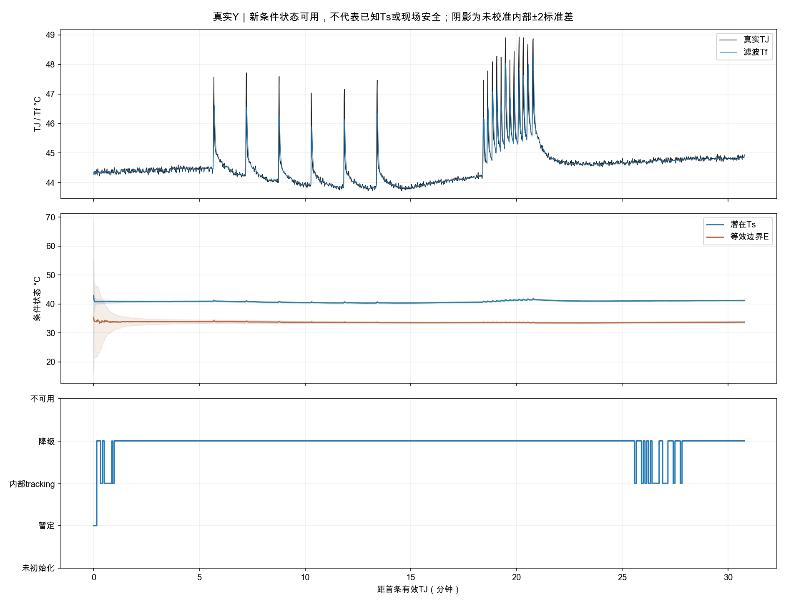
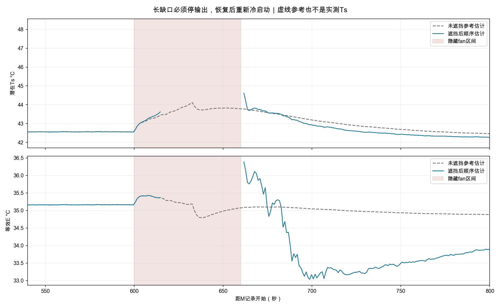
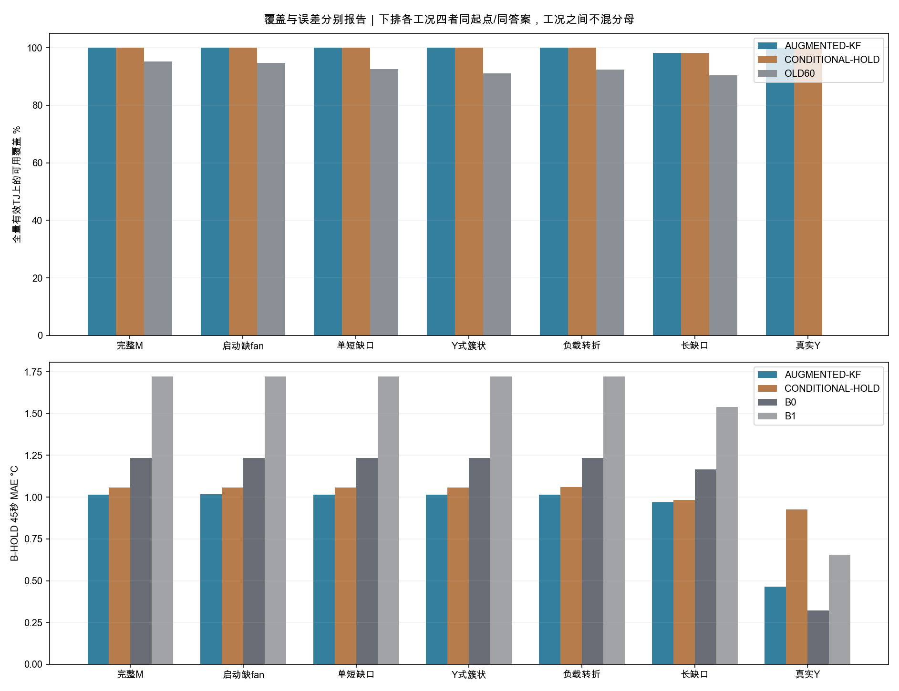
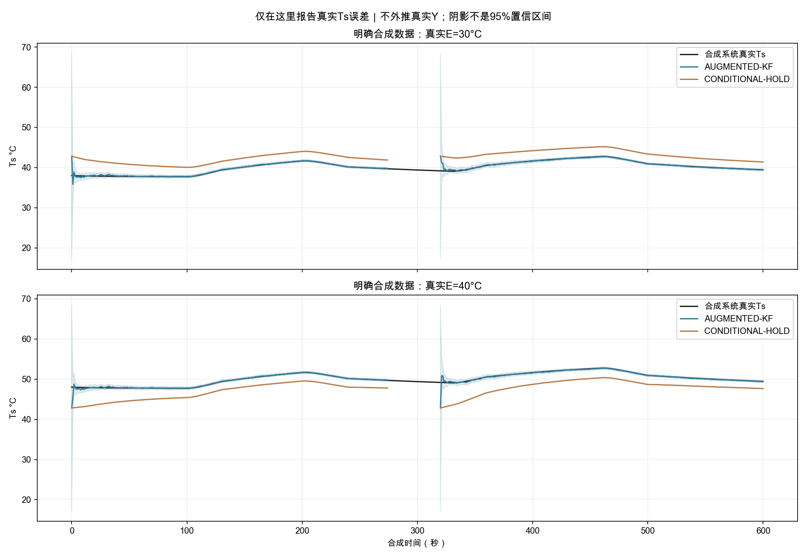

# TTO-缺测状态估计与冷启动-R2报告

**2026-10-18｜Issue #8模型线｜实际离线实现与验证；不连接设备、不修通讯、不调度负载**

这次做成的是“有真实TJ时可以先给带条件、带未知程度的快慢热状态”，而不是等整轮出现60秒完美输入才能启动。冻结G2动态参数不变，新增顺序状态估计与朴素条件保持参照。真实Y中，顺序估计有1843/1843个有效TJ起点可给条件状态（100.0%）；旧严格方法仍是352段、最长26.013秒、0状态，原结果未改。

**资格必须另看：这1843个可用状态中，只有97个满足本研究内部tracking门槛，1737个为degraded、9个为provisional。** 缺口不计入5秒上下文确认时间，恢复后重新计时；热状态历史仍可保留。这不是整轮100%正常或100%可准入。五种M遮挡是同一个连续热过程的派生副本，不是五轮独立实测；Y的18条请求也是同一个热过程。

**可输出状态不等于预测成功或现场安全。** Y的45秒B-HOLD同集合1787个答案上，顺序估计MAE 0.465°C，朴素参照0.926°C，B0保持TJ为0.323°C：改善了朴素参照，仍未胜过B0，最大欠预测4.739°C。给定记录未来真实输入的A类45秒有0个共同答案，MAE 不可用°C；无答案写不可用，不填零误差。

M在相同2447个起点上，45秒A为0.193°C、B为1.015°C，B最大欠预测11.469°C。主要价值是冷启动和有界保留热历史；明显短板是负载转折/连续短问答的未来输入假设。A的好成绩、内部tracking或高覆盖都不能冒充B可靠、Ts实测或控制收益。

短HTTP缺口可以保留热历史并明确假设PWM条件保持；原PWM一旦失效仍标无效。长缺口停输出，显式guard/fault/非AUTO不输出正常状态，绑定/default/未知控制状态不变成正常。内部tracking只是本研究的数值/当前观测门槛，不是安全准入。潜在Ts没有真实测量答案，YET和未知时钟不用于纠偏或评分。

**唯一推荐下一步：把本候选和只读接口交#9/#10做一次离线集成复审。** 先确认它在失联、恢复、明确控制改变时的语义与误差能被正确消费；本轮不因此启动新实测、在线学习、风扇控制或软件发布。

## 1. 来源与冻结

独立checkout基线 b85ccae98257c21b220d988c1afcfeae9f27c656；现场0.2.4身份另由manifest全部22份源SHA核对，不能以公开main代替现场版本。复用包内原字节Y比较、M实测和原vendor/模型；28项交接成员SHA/CRC通过。先实际复现旧Y：15份科学输出与原包逐字节一致，三模型合法状态仍全0。

新spec SHA：2080adcf20773650299def2bb0f3ebdb9f87d8f85281d5b87a99d8b406c83c6b；模型primary SHA：dff52c3e641d54bd07f0b5543909166e11a5d935c92474ab9f7b4a08c5396ff0，deployable=false。数值规则在首个新方法评价前冻结，M只作遮挡开发，Y新回放前再次封存代码/spec；没有选参循环或θ重拟合。该冻结θ历史上已用L+M+S拟合，因此M成绩不是留出验证；Y也是已分析过的开发资料，不叫最终泛化。

冷启动E中心仅取冻结L/S训练侧中位数35.285891°C，标准差10°C；Ts−E中心仅取L/S旧段初态偏移中位数7.545233°C，标准差8°C。两者建立相关先验，Tf第一次锚当前有效TJ；未设Tf=Ts或热平衡，未取E_M/Ts_M/新run完整前缀/默认24°C。新E是仅过去TJ推断的边界状态，既不是室温真值，也不是动态θ学习。旧M的24°C未移到Y。

## 2. 实际模型与缺测政策

沿用dTf/dt=a(Ts−Tf)+b_g·P_GPU+b_c·P_CPU_SOC_MSS；dTs/dt=c(Tf−Ts)−(d0+d1·u)(Ts−E)。动态θ固定；增广E按常值边界加小过程噪声建模。顺序方法用精确矩阵指数传播和TJ更新；朴素参照只锚Tf、保持既有Ts/E条件历史，不用TJ残差校正慢态/边界。两个rail独立输入，CPU/SOC/MSS不是纯CPU；没有任意相加5V或把gain作物理冷却输入。

原source新鲜度、fan 2.5秒、temp状态7.5秒不变。新字段可在短缺口中保持最后成功PWM，启动未知PWM取0.5并保留全[0,1]范围；它不是续龄的实测PWM。最后成功fan实际年龄超过15秒、TJ/功率超过10秒、控制上下文超过15秒时停输出并清除内部状态，下次从注册先验冷启动。guard/fault/非AUTO/手动状态阻断正常输出；绑定/default/失温/未知状态保留证据并阻断tracking。真正源epoch/长源缺口重建状态；任务/工作块边界不重置。

tracking还要求当前真实测量/安全上下文满足合同、上下文稳定5秒、至少10次TJ更新和注册协方差尺度门槛。有限值不足以进入tracking。协方差、输入假设、原引用/时间/年龄/到期、边界投影及拒绝原因逐点保存；内部±2标准差没有校准为95%区间，也不包含θ误差、真实环境变化或时钟误差。

这不是把60秒改成10个点：第一个有效TJ即可产生宽先验的provisional状态；样本数只是最低门槛。朴素参照即使超过60次TJ更新仍因慢态/边界不确定而保持provisional，短缺口/未知控制也不能仅靠计时进入tracking。它仍可作为同条件数值参照参与评价。

## 3. 遮挡、来源隔离与全量覆盖

M按固定时间生成启动12秒、单6秒、Y首个多超时60秒时间块、首个工作块转折[-2,+6]秒及60秒长缺口五种遮挡。只按事件时刻/类型选fan行；整条fan响应移除后才进native处理器与估计器。隐藏PWM不进入初态/E校准、质量旁路或参数选择；只在A类评价oracle及未遮挡参考中可见。副本、mask清单及原/新SHA另存，原M不变。

| 场景 | 全量有效TJ分母 | 顺序估计可用 | 朴素参照可用 | 旧60秒可用 |
|---|---:|---:|---:|---:|
| 完整M | 2504 | 2504（100.0%） | 2504（100.0%） | 2382（95.1%） |
| 启动缺fan | 2504 | 2504（100.0%） | 2504（100.0%） | 2370（94.6%） |
| 单短缺口 | 2504 | 2504（100.0%） | 2504（100.0%） | 2317（92.5%） |
| Y式簇状 | 2504 | 2504（100.0%） | 2504（100.0%） | 2279（91.0%） |
| 负载转折 | 2504 | 2504（100.0%） | 2504（100.0%） | 2314（92.4%） |
| 长缺口 | 2504 | 2458（98.2%） | 2458（98.2%） | 2262（90.3%） |
| 真实Y | 1843 | 1843（100.0%） | 1843（100.0%） | 0（0.0%） |

可用包含provisional/degraded；各阶段、tracking分数和每时距标签覆盖另存，不把它们混成“正常覆盖”。温度标签独立按15/45/90秒判断，45秒有答案、90秒无答案的起点保留；共同集合还要求B0/B1均有资格。共同集合SHA逐组保存。背景、升温/负载、回落均保留，不靠删除待机或混合不同起点制造胜出。

## 4. B：只用起点已到达信息，未来固定HOLD

下表每一行四种方法使用相同起点和同一真实TJ答案。预测Tf统一锚当前真实TJ，以比较慢态/E处理；滤波Tf另存。HOLD固定当前两rail及已知/声明的条件PWM，没有读取真实任务结束或未来输入。

| 场景 | 时距秒 | 共同答案数 | 顺序MAE °C | 朴素MAE °C | B0 MAE °C | B1 MAE °C | 顺序欠预测P95 °C |
|---|---:|---:|---:|---:|---:|---:|---:|
| 完整M | 15 | 2477 | 0.332 | 0.371 | 0.481 | 0.492 | 0.468 |
| 完整M | 45 | 2447 | 1.015 | 1.059 | 1.233 | 1.721 | 4.053 |
| 完整M | 90 | 2402 | 1.916 | 1.935 | 2.069 | 3.701 | 8.766 |
| 启动缺fan | 15 | 2477 | 0.332 | 0.368 | 0.481 | 0.492 | 0.468 |
| 启动缺fan | 45 | 2447 | 1.017 | 1.056 | 1.233 | 1.721 | 4.050 |
| 启动缺fan | 90 | 2402 | 1.919 | 1.933 | 2.069 | 3.701 | 8.765 |
| 单短缺口 | 15 | 2477 | 0.332 | 0.371 | 0.481 | 0.492 | 0.468 |
| 单短缺口 | 45 | 2447 | 1.015 | 1.059 | 1.233 | 1.721 | 4.053 |
| 单短缺口 | 90 | 2402 | 1.916 | 1.935 | 2.069 | 3.701 | 8.767 |
| Y式簇状 | 15 | 2477 | 0.332 | 0.371 | 0.481 | 0.492 | 0.468 |
| Y式簇状 | 45 | 2447 | 1.015 | 1.059 | 1.233 | 1.721 | 4.053 |
| Y式簇状 | 90 | 2402 | 1.916 | 1.935 | 2.069 | 3.701 | 8.766 |
| 负载转折 | 15 | 2477 | 0.332 | 0.371 | 0.481 | 0.492 | 0.460 |
| 负载转折 | 45 | 2447 | 1.016 | 1.060 | 1.233 | 1.721 | 4.053 |
| 负载转折 | 90 | 2402 | 1.917 | 1.937 | 2.069 | 3.701 | 8.767 |
| 长缺口 | 15 | 2431 | 0.296 | 0.326 | 0.441 | 0.424 | 0.417 |
| 长缺口 | 45 | 2401 | 0.970 | 0.983 | 1.167 | 1.538 | 4.274 |
| 长缺口 | 90 | 2356 | 1.894 | 1.856 | 1.999 | 3.373 | 9.026 |
| 真实Y | 15 | 1818 | 0.311 | 0.642 | 0.217 | 0.307 | 0.645 |
| 真实Y | 45 | 1787 | 0.465 | 0.926 | 0.323 | 0.654 | 1.151 |
| 真实Y | 90 | 1742 | 0.608 | 1.108 | 0.332 | 1.015 | 1.365 |

完整逐点预测、各自全量覆盖/误差、tracking子集、分阶段统计、三方法共同集合及最大欠预测/欠预测>2°C比例在结果JSON中。2°C只是描述尾部的阈值，不是安全阈值。旧方法Y无状态，三方共同集合为0时写不可比，不能填一个0误差。

旧60秒、顺序方法和朴素参照在三者共同起点/标签上的45秒B比较如下；它与上表两者共同集合的分母不同，不能横向当成同一排行榜：

| 场景 | 三方共同答案数 | 顺序MAE °C | 朴素MAE °C | 旧60秒MAE °C |
|---|---:|---:|---:|---:|
| 完整M | 2336 | 1.059 | 1.104 | 1.054 |
| 启动缺fan | 2324 | 1.064 | 1.109 | 1.058 |
| 单短缺口 | 2271 | 1.088 | 1.134 | 1.083 |
| Y式簇状 | 2233 | 1.106 | 1.153 | 1.101 |
| 负载转折 | 2268 | 0.938 | 0.989 | 0.936 |
| 长缺口 | 2216 | 0.979 | 0.996 | 0.952 |
| 真实Y | 0 | 不可用 | 不可用 | 不可用 |

另外保留候选tracking子集：Y的45秒B共同97点，顺序MAE 0.152°C，B0为0.067°C。这里仅要求候选tracking、其余参照有可用数值；同时保留all_available和all_methods_tracking（可能为空），不在事后选择较好子集替代全量结果。

分阶段45秒B能看出平均数隐藏的动态问题。阶段按起点的实际记录归属，预测窗可能跨到下一段；M20/M60/M180是既有工作块标签，不保证实际请求恰好20/60/180秒：

| 记录 | 起点阶段 | 共同答案数 | 顺序MAE °C | B0 MAE °C | 顺序最大欠预测 °C |
|---|---|---:|---:|---:|---:|
| 完整M | M180 | 193 | 2.366 | 3.640 | 10.829 |
| 完整M | M20 | 32 | 9.855 | 5.078 | 0.305 |
| 完整M | M60 | 65 | 6.449 | 6.195 | 11.301 |
| 完整M | cooldown_1 | 419 | 1.020 | 1.247 | 11.387 |
| 完整M | cooldown_2 | 598 | 0.747 | 0.971 | 11.469 |
| 完整M | final_cooldown | 553 | 0.174 | 0.578 | 1.106 |
| 完整M | resident_background | 587 | 0.550 | 0.559 | 10.300 |
| 真实Y | between-groups | 300 | 0.320 | 0.332 | 4.104 |
| 真实Y | continuous | 143 | 2.689 | 1.262 | 4.739 |
| 真实Y | final-cooldown | 552 | 0.182 | 0.107 | 0.349 |
| 真实Y | outside_phases | 29 | 0.056 | 0.064 | 0.142 |
| 真实Y | resident-baseline | 298 | 0.117 | 0.119 | 3.100 |
| 真实Y | sparse | 465 | 0.458 | 0.430 | 3.628 |

Y连续短问答明显弱于B0；M20等短工作块结束/下一工作块到来时，固定HOLD既可能高估持续时长，也可能漏掉未来峰值。M全量A明显低于B的误差支持“未来输入信息是重要限制”，不排除结构/初始化/测量误差。当前没有开发请求预测器。

## 5. A：给定记录中未来真实输入，冻结初态自由传播

A仅读未来成功PWM和真实rail，在原TTL内形成完整物理输入路径；中途没有TJ反馈。未来路径缺失则不评分。它是R2单列的物理输入诊断合同，控制上下文另分层；原严格评分合同/历史0结果原封保留，不静默换口径。M遮挡的隐藏输入只在这一评价oracle内使用，不回流估计器。

| 场景 | 时距秒 | 共同答案数 | 顺序MAE °C | 朴素MAE °C |
|---|---:|---:|---:|---:|
| 完整M | 15 | 2477 | 0.170 | 0.206 |
| 完整M | 45 | 2447 | 0.193 | 0.241 |
| 完整M | 90 | 2402 | 0.221 | 0.286 |
| 长缺口 | 15 | 2431 | 0.161 | 0.188 |
| 长缺口 | 45 | 2401 | 0.214 | 0.227 |
| 长缺口 | 90 | 2356 | 0.258 | 0.267 |
| 真实Y | 15 | 33 | 0.085 | 0.730 |
| 真实Y | 45 | 0 | 不可用 | 不可用 |
| 真实Y | 90 | 0 | 不可用 | 不可用 |

## 6. 初态、恢复与潜在状态的证据边界

长M缺口：AUGMENTED-KF available恢复延迟1.726秒；AUGMENTED-KF tracking恢复延迟9.733秒；CONDITIONAL-HOLD available恢复延迟1.726秒；CONDITIONAL-HOLD tracking恢复延迟不可用秒。这里可用恢复与tracking恢复分别计时，不能合并为一个“已恢复正常”。每个短/簇状/转折/启动缺口的恢复延迟、冷启动次数、Ts/E与未遮挡参考的逐点差异均保存。完整M参考同样是模型估计，不是实测Ts；绝不把这些差值写成真实慢态误差。

隐藏PWM与假设PWM的偏差只在评价层另算。部分短/簇状遮挡处于背景、实际PWM变化很小，条件保持因而受益；这些情景不能证明遇到所有快速PWM变化都准确。没有据隐藏值另挑更有利遮挡或调噪声/停止门槛。

只有已知状态的合成系统可报告真实Tf/Ts/E误差。两种真实E、固定seed与原θ、独立ODE真值均已实际执行，不以这组同结构成功外推真实硬件：

| 合成真实E °C | 方法 | 可用/全量 | 真实Ts MAE °C | 落在内部±2标准差比例 |
|---|---|---:|---:|---:|
| 30 | AUGMENTED-KF | 556/601 | 0.089 | 100.0% |
| 30 | CONDITIONAL-HOLD | 556/601 | 2.543 | 100.0% |
| 40 | AUGMENTED-KF | 556/601 | 0.090 | 100.0% |
| 40 | CONDITIONAL-HOLD | 556/601 | 2.683 | 100.0% |

经验包含比例仅描述这两个注册合成系统，不能把未校准带宽改名95%置信区间。真实Y没有Ts真值，局部鳍片表面也不是Ts；仪表误差界/接触响应问题仍未解决。本轮新估计器与评价器不读取外部温度、照片、时钟拟合或新环境温度。

## 7. 四张中文图

图1：Y的真实TJ、滤波Tf、潜在Ts/等效E及状态阶段；阴影是内部模型尺度，Ts不是实测表面。阶段线从不自动许可发负载。

图2：M长缺口的断输出与恢复。未遮挡曲线也只是参考估计；断线是明确不可用，不插值填上。

图3：可用覆盖与45秒B误差各占一排；下排每个工况内四者同起点/同标签，工况之间不混分母。

图4：明确合成的真实Ts与两方法，展示初态偏差、缺口和内部尺度；只在此图可讨论真实Ts误差。

## 8. 给#10的只读接口和验收

选择本地JSONL一种传输；schema为TTO-STATE-READONLY-R2-v1，五组identity/measurement/observer/safety/permission。identity含run/config/firmware（未知保留null）/collector/model/spec和源epoch；generation为明确虚拟回放时钟，观测截止/原始引用另列。measurement保留真实TJ/rail及最后成功PWM的原时刻、真实年龄/到期与raw_valid；observer另存条件值和假设。safety未知为null，不写false/normal；permission始终local_demo=true、formal_field_authorized=false。

consume_example.py只读取/展示，不轮询主板、不发请求、不代做#10调度。模型信息就绪是一个条件；#10还需结合可信当前读数、保护政策、仪表/时钟与实际授权。通讯源码候选身份由#9核对，本线没有修collector或WS。所有输出均研究态，不部署或现场放行。

实际新增测试回执：

~~~text
.................                                                        [100%]
17 passed in 0.96s
~~~

覆盖精确数值/协方差PSD、训练侧冷先验、短缺口不续龄、长缺口停输出及恢复、明确guard/fault/mode/binding/source边界、隐藏PWM/未来TJ/表面温度非干扰、未知安全不准入，以及最终共同集合/逐时距标签/旧0状态。只验证本线新增风险链，没有展开全仓防御审查。

资源：macOS-27.0.1-arm64-arm-64bit，Python 3.12.14，NumPy 2.2.6 / SciPy 1.16.3；CPU/BLAS 1线程、无CUDA。数值回放/测试阶段墙钟88.59秒，峰值RSS原生单位918257664（bytes on macOS; KiB on Linux）；后续报告绘图/打包不计入此数字。这是本机离线资源，不是N305现场成绩。运算网络尝试0，θ更新0。

## 9. 重跑、交付与停止

全入口：python run_study.py --output 一个不存在的新目录；Python3.12与requirements.txt研究依赖、C编译器及中文字体。依赖准备与实际离线计算分开。代码/patch、冻结spec、来源/SHA、M遮挡、全部状态/预测/内部尺度、旧复现、合成真值、测试、资源、中文图与只读消费示例一起交回；原私有归档不上传GitHub。

本轮完整执行#8，不按“只补差异”缩小范围；既有模型/数据/旧成绩保留复用。研究实现交独立复审，现场待验。未提交、推送、创建软件PR、连接设备、部署、修改AUTO/曲线/gain/保护/TTL或启动下一轮实测。
