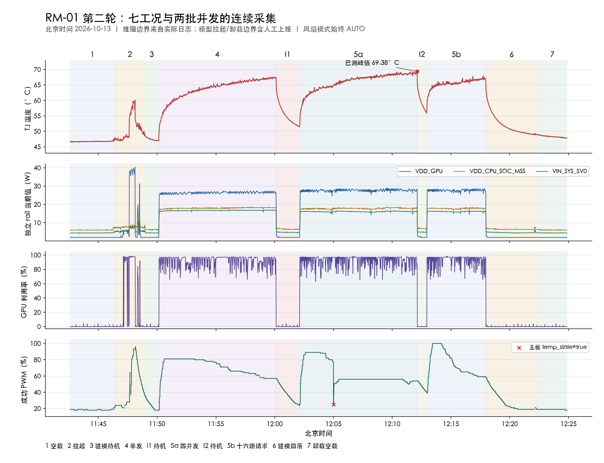

# TTO第二轮实机采集分析

采集时间：2026-10-13 11:42:36.010–12:24:52.386（北京时间），42分16.377秒。用户要求提前停止，stop_reason=SIGINT，进程退出0，报告生成成功。旧轮数据保留，本轮独立run 929742d7-6f4d-4d80-b53e-4436d45ac12c。

## 各工况统计

温度使用TJ；功耗按三个不同rail分别列出，不相加冒充整机输入功耗。平均值使用有效新样本的算术平均，风扇使用成功返回且年龄不超过2.5秒的实际PWM，未测值不填零。GPU使用NVML有效利用率。以下区间包含负载起始和结束过渡，不代表纯稳态。

| 工况 | 统计区间 | TJ均值/峰值 °C | GPU均值 % | GPU功耗 W | CPU/SOC/MSS功耗 W | 5V rail W | PWM均值/范围 % |
|---|---|---:|---:|---:|---:|---:|---:|
| 1 空载待机 | 11:42:36–11:46:24 | 46.74/47.84 | 0.13 | 1.98 | 6.01 | 4.42 | 18.5/18–21 |
| 2 模型拉起 | 11:46:24–11:48:58 | 50.69/60.12 | 36.67 | 10.76 | 7.86 | 6.01 | 46.3/21–96 |
| 3 模型驻留待机 | 11:48:58–11:50:06 | 47.50/48.84 | 0.15 | 1.98 | 6.28 | 4.43 | 24.1/18–36 |
| 4 单发推理 | 11:50:06–12:00:06 | 63.70/67.59 | 91.54 | 26.25 | 17.91 | 16.62 | 70.8/18–81 |
| I1 单发后短暂驻模待机 | 12:00:06–12:02:06 | 55.11/65.00 | 0.14 | 2.20 | 6.57 | 4.80 | 37.7/24–57 |
| 5a 4路并发 | 12:02:06–12:12:06 | 66.11/69.38 | 92.50 | 27.59 | 17.75 | 16.04 | 63.3/24–89 |
| I2 两批并发之间驻模待机 | 12:12:06–12:12:56 | 59.39/68.84 | 1.82 | 2.79 | 7.06 | 5.12 | 47.1/40–54 |
| 5b 16路请求并发测试 | 12:12:56–12:17:56 | 65.55/67.97 | 92.97 | 27.61 | 17.75 | 16.09 | 74.8/39–100 |
| 6 推理后模型驻留待机 | 12:17:56–12:22:21 | 51.86/65.44 | 0.52 | 2.11 | 6.50 | 4.65 | 27.8/19–59 |
| 7 模型kill后空载待机 | 12:22:21–12:24:52 | 48.31/48.97 | 0.11 | 1.98 | 6.01 | 4.42 | 18.9/18–19 |

## 温度传感器明细

下表为均值/峰值（°C）。原始计算值保存在statistics.json。

| 工况 | CPU | GPU温度 | SOC012 | SOC345 |
|---|---:|---:|---:|---:|
| 1 | 46.17/47.84 | 46.72/46.94 | 45.53/46.22 | 45.40/45.69 |
| 2 | 49.48/54.47 | 50.50/60.12 | 48.49/53.00 | 48.41/54.59 |
| 3 | 47.02/48.84 | 47.50/48.53 | 46.43/47.81 | 46.23/47.47 |
| 4 | 61.52/65.12 | 63.70/67.59 | 60.50/64.19 | 62.04/65.84 |
| I1 | 54.58/63.81 | 55.11/65.00 | 54.49/63.66 | 54.02/63.78 |
| 5a | 63.82/66.62 | 66.12/69.38 | 62.81/65.47 | 64.30/67.09 |
| I2 | 58.84/66.47 | 59.39/68.94 | 58.93/65.34 | 58.44/67.00 |
| 5b | 63.22/64.91 | 65.55/67.97 | 62.38/64.03 | 63.72/65.38 |
| 6 | 51.35/63.75 | 51.86/65.44 | 51.10/63.72 | 50.69/63.81 |
| 7 | 47.77/48.34 | 48.31/48.94 | 47.27/47.91 | 47.06/47.69 |

## 温度、功耗与风扇的变化

- 模型拉起历时2分34秒，TJ最高60.13°C、GPU rail瞬时最高40.392 W，PWM最高96%。该阶段包含加载、初始化等操作，不能按稳定推理负载解释。
- 拉起后的驻模待机GPU均值0.15%，GPU rail仍为1.984 W，说明模型驻留本身不等于持续GPU运算。驻模待机温度均值47.50°C，但只有约69秒，仍处于加载后的回落过程。
- 单发推理TJ均值63.70°C，4路并发66.11°C；GPU均值91.54%与92.50%。4路并发GPU rail均值27.59 W，比单发26.25 W高约1.34 W。三条功耗rail必须分别理解。
- 16路请求GPU均值92.97%、GPU rail均值27.61 W，与4路很接近。操作日志确认仅9路有过输出，其余存在排队，到期有12个客户端超时事件；不能称为服务端16路同时执行，更不能据此认定16并发性能或吞吐。该批只运行5分钟，且PWM明显更高，温度低于4路批次不能解释成16路更省电或发热更小。
- 本轮实测TJ最高69.375°C，出现在12:12:06.323的4路并发末段。没有整段采集中断，accepted TJ最长相邻接收间隔约2.003秒。
- 16路批次结束后，TJ从首个样本65.437°C回落到工况7上报前48.906°C，PWM从59%降到19%；这一阶段模型仍驻留，但末段可能已包含卸载。
- 模型kill后正式标记的约2分31秒空载阶段，TJ从48.937°C降到47.843°C，PWM从19%降到18%。结束温度高于最初空载均值46.737°C约1.11°C；仍有热残留，未证明已完全回到初始热平衡。
- 风扇API所有有效样本都为auto，对应用户所说TTI智能模式。模式没有切换，PWM会变化。拉起峰值96%、16路请求阶段峰值100%（12:13:25.385）；温度变化率和控制历史会影响PWM，不能只按即时TJ大小比较。rpm字段未提供有效测速证据，本报告仅分析PWM，不能报告实际转速。

## 时间边界与数据质量

- 工况2开始11:46:24、工况3开始11:48:58来自用户人工提供，精确到秒但未用模型启动日志核验。各批推理起止与首次输出来自实际负载程序日志。
- 工况7起点用用户状态上报的写入时刻12:22:21.734作近似，不声称这是精确kill时间。遥测显示RAM在12:22:14.859已降到约1.29 GB，至少比上报早约6.9秒；因此工况6末尾包含一段卸载边界不确定区间。不能从RAM下降推导精确kill命令时刻。
- 单发结束到4路开始之间约2分0.137秒、4路结束到16路开始约49.859秒均独立列为I1/I2待机间隔，没有混入推理平均。
- 原始观察7888条，Thor事件2534条，其中2529条有效新样本、5条重复；dropped=0，连接尝试1次。8个已索引文件SHA-256均校验通过，包含operator-records.jsonl。
- 本轮3次风扇请求TimeoutError：11:47:11.541、11:47:43.869（模型拉起）、12:22:07.319（模型kill状态上报之前、名义工况6，不能凭此认定与kill有关）。
- 本轮1次主板temp_stale=true：12:04:59.757，4路并发阶段，成功返回的PWM为25%。这与HTTP超时分开保留；本轮未重新执行根因调查，不能仅因现象类似而把上轮诊断逐次套用。
- 本轮采集提前结束，因此未触发原计划12:37:36提醒。定时监控已暂停；没有擅自延长、重启采集或更改控制策略。

## 文件

原始run、操作事件、会话设置、采集/报告日志、有效样本CSV、完整统计JSON及本报告均随本轮独立归档保存。产品代码未修改。

