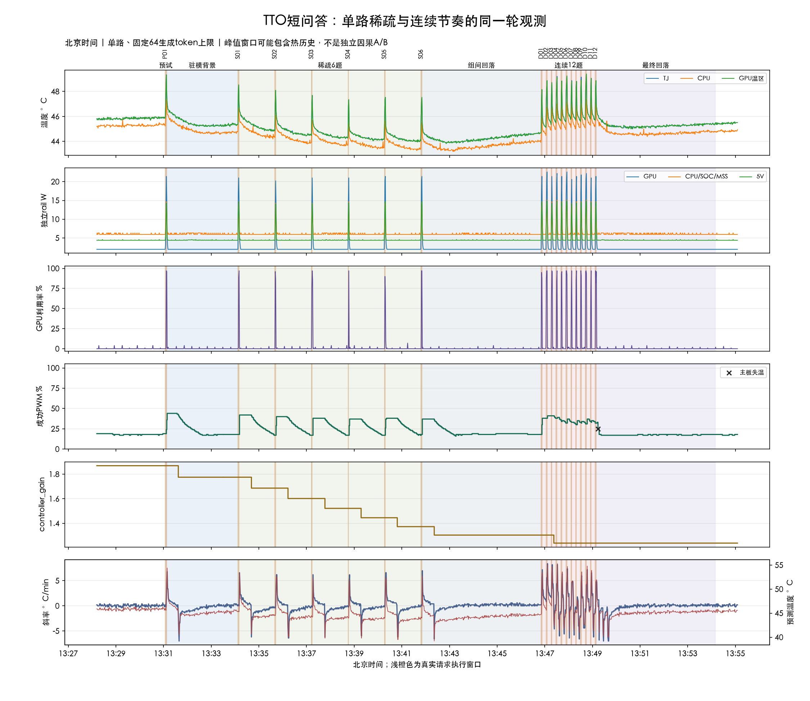
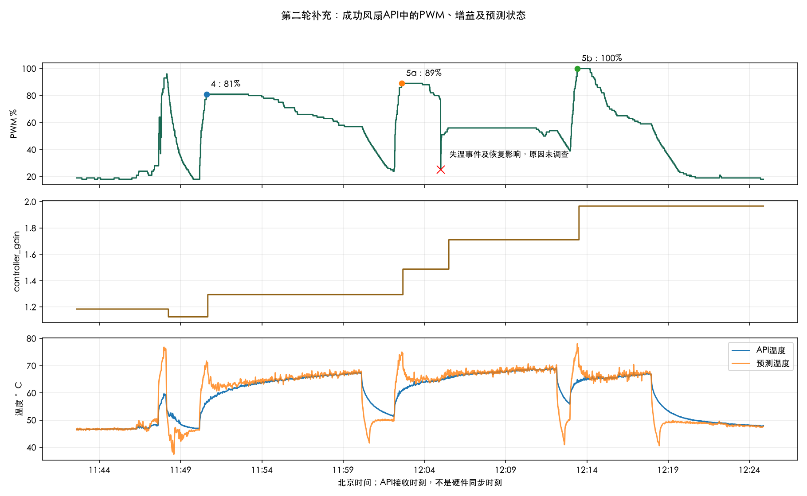

# TTO-第二轮补充与短问答实测报告

计划：TTO-SHORT-QA-v1.0。旧七工况只做原始数据核对，另行执行一轮单路短问答连续采集。未修改生产代码、控制设置、采样频率或部署，未训练、未提交推送，未重跑七工况。

## 本轮主要结果

- 稀疏题的PWM峰值为37%～42%，首次峰值常在客户端结束后约0.6～2.7秒被采到；接近峰值（峰值减1个百分点）的最后快照在结束后约30.6～33.0秒，说明PWM有明显拖尾。+60秒仍为24%～26%，下题前回到17%～18%。没有观测到逐题温度或PWM越积越高，gain从1.775260降到1.373662。
- 连续组任务前TJ由44.66°C先升至约45.7°C，之后在45.6～45.8°C附近波动，并非逐题单调增加。PWM在初始18%后进入32%～41%的累积输出区间，但未持续向更高档爬升；gain由1.304979降到1.239730后保持，没有增益累加上升。两组全部成功PWM快照均未达到80%。
- D12后的13:49:13.645主板失温将PWM从33%切到25%，下一次有效快照13:49:16.638为18%；因此最终回落初段的降档带有异常/恢复影响，不解释成单纯智能降低散热需求。D12的+5秒25%明确受影响，后续15/30/60秒虽恢复有效，也保留控制历史影响。原因未调查。
- 最终300秒回落末TJ约45.44°C、PWM低档、gain保持1.239730。不能凭此确认整体热平衡或储热已经清空；组间环境/缓存/控制历史未排除。

- 稀疏组完成6条，实际请求时长1.54～2.54秒，均值2.18秒。结束后至下一题前观测到PWM高于结束时快照的请求：S01, S02, S03, S04, S05, S06。这只是对应窗口行为，不分摊单题因果。
- 稀疏组任务前TJ序列：45.38 / 44.84 / 44.47 / 44.28 / 44.16 / 44.03 °C；PWM序列：18 / 17 / 17 / 17 / 17 / 18 %；gain序列：1.775260 / 1.686497 / 1.602172 / 1.522063 / 1.445960 / 1.373662。连续组按实际顺序展示是否积热，不称独立因果A/B。
- 连续组完成12条，实际请求时长1.90～3.16秒，均值2.38秒。结束后至下一题前观测到PWM高于结束时快照的请求：D01, D02, D04, D05, D06, D08, D09, D10, D11, D12。这只是对应窗口行为，不分摊单题因果。
- 连续组任务前TJ序列：44.66 / 45.09 / 45.34 / 45.47 / 45.72 / 45.56 / 45.81 / 45.69 / 45.59 / 45.72 / 45.78 / 45.69 °C；PWM序列：18 / 38 / 41 / 38 / 36 / 32 / 34 / 31 / 33 / 32 / 34 / 32 %；gain序列：1.304979 / 1.304979 / 1.304979 / 1.239730 / 1.239730 / 1.239730 / 1.239730 / 1.239730 / 1.239730 / 1.239730 / 1.239730 / 1.239730。连续组按实际顺序展示是否积热，不称独立因果A/B。
- 本轮采集 13:28:11.445～13:55:05.414（北京时间），负载程序在13:54:09完成，至13:55:05采集收尾约56秒另保留为被动收尾记录，不纳入规定300秒回落的统计；负载程序状态completed；有效新TJ样本1610，原始观察4809条。
- HTTP读取异常0个，设备失温快照1个；分别标记，未调查原因。

## 第二轮补充核对

核对原run 929742d7-6f4d-4d80-b53e-4436d45ac12c；8项原始索引SHA全部一致。旧报告、原始数据及既有PR均未改动。

### 核对一致

| 工况 | 首次API峰值 | PWM | API温度 | 斜率 °C/min | gain | 距客户端提交约秒 |
|---|---|---:|---:|---:|---:|---:|
| 4 | 2026-10-13T03:50:35.393892+00:00 | 81 | 56.9 | 19.8 | 1.124666 | 28.782 |
| 5a | 2026-10-13T04:02:36.792594+00:00 | 89 | 60.9 | 18.8 | 1.293365 | 29.938 |
| 5b | 2026-10-13T04:13:24.890299+00:00 | 100 | 64.9 | 17.6 | 1.710476 | 28.045 |

- 外部10个阶段的previous/first/peak/last原始引用、状态字段及fan样本数逐项核对一致。三个峰值均auto/active、guard=false、stale=false。5b 100%时预测78.1°C，实测API温度64.9°C；不等于保护触发。
- gain变化的6个原始引用一致；分别为1.183859→1.124666→1.293365→1.487370→1.710476→1.967047，属于运行控制状态，不是TTO训练。
- 16路批次：{'workers': 16, 'attempts': 21, 'completed': 5, 'errors': 12, 'workers_ever_output': 9}。前130秒10秒输出增量窗口仅worker6/7/9/11有增长；原始progress逐条一致。
- 1次设备stale与3次HTTP超时分别核对一致。失温处77%→25%→37%→47%→49%→51%的实际轨迹保留，影响窗口与后续控制历史单独说明；不调查原因。

资源数组（CPU/RSS/预测耗时/HTTP RTT）的均值、P95、P99、最大值也已逐项重算一致；仅支持本次collect资源观察，不推广到训练或整机性能。

### 发现差异

- 旧报告图表的100%点时间12:13:25.385来自TJ采样时刻上的as-of PWM；独立补充12:13:24.890是首次成功fan API返回。两者时间轴不同，相差约0.495秒，不是原始PWM峰值数值冲突。
- 工况3旧表PWM峰值36%，独立API区间峰值35%。旧表在首个新TJ采样上匹配了区间开始前尚在2.5秒年龄许可内的36%快照；独立分析只选区间内部fan返回。保留旧表口径并说明差异，不覆盖数据。
- 旧报告关于结束温度高1.11°C的“仍有热残留”表述偏强。确认的是结束TJ仍高于初始空载均值，缺少环境温度等证据，不能据此确认剩余储热量或排除环境变化；本补充收窄解释。

### 当前证据不足

- 服务端同时执行数未知；16路客户端、累计9路输出、10秒窗口4路内容增长、用户所说8路配置不是同一量。
- 首峰约28～30秒是跨主机客户端日志与fan接收时间之差，未有旧轮独立时钟校准；不能据此宣称亚秒物理响应或唯一趋势窗口原因。
- 固件manifest身份与实际基础曲线快照缺失，引用的main公式仅是机制线索，不分摊精确因果贡献。
- 通讯、手动刷新、锁竞争或WS故障均未在本次证明。红叉只保留事件与影响。
- 热容、整体储热是否清空、噪音收益，以及各阶段独立因果效果均不能由这些数据确认。

用户曲线文件：待合并。后续短问答按固定方案执行，不为迎合外部分析改变参数。

## 本轮配置与时间口径

- TTO现场版本0.2.2，Thor/NVML合同，原1秒TJ/风扇与5秒主板温度轮询保持不变。模型为原RM-01 VLM；API公告的模型root与旧轮一致，未核验权重字节哈希。设备实时报出的固件版本单独保存，不把git短提交当闪存SHA证明。
- 原模型驻留、AUTO及已有全部控制设置保持；既有gain起点照实记录，没有清零。用户基础曲线文件尚未收到：待合并，与controller_gain时间序列分开。
- 正式请求每题独立，不累计对话，默认temperature/top_p/template/cache不改。预试一条自然结束3.612秒后冻结max_tokens=64；max_tokens字段已被接口接受，usage生成token逐条保存；未出现单独思考字段，未另行核验隐藏内部过程，不能靠60字要求宣称约束了隐藏思考。
- TTO与负载在同一N305主机运行，UTC与monotonic均记录；客户端提交和协议完成不是GPU内核精确起止。日志中的first_network_packet实际是首次读到的SSE行时间，不是抓包确认的TCP首包；首模型内容/首可见内容另列。
- 当前状态/metrics在执行前及逐题前只读检查，未发现此前任务仍运行或请求排队。自然额外负载不能仅靠本轮日志完全排除。
- 所有wait从上一条client_end的monotonic起算，90秒或10秒等待后加上只读检查与请求准备的少量耗时，实际间隔逐条保存。最长40分钟，没有延长或重跑。采集开头额外记录了约3分钟脚本准备背景，规定180秒背景仍另外完整执行；该额外观察与正式组分开，准备阶段已计入本轮硬截止，属于执行偏差。
- 峰值窗口为提交到下一条本组提交之前；最后一条到本组300秒回落结束。窗口叠加历史，峰值不归因于单条请求。
- 新TJ仅使用已保存accepted新样本；PWM仅用成功且as-of年龄≤2.5秒记录，缺失不补0，API与TJ仍异步。独立rail单列、不当整机输入。

## 实际请求起止与首内容

全部时间为同采集主机客户端日志的北京时间。首模型内容与首可见内容、首SSE行在逐请求日志分开保存。

| 请求 | 提交 | 首模型内容 | 客户端完整结束 | 距上一请求结束秒 |
|---|---|---|---|---:|
| P01 | 13:31:03.781 | 13:31:05.460 | 13:31:07.394 | 首条 |
| S01 | 13:34:07.430 | 13:34:07.872 | 13:34:09.966 | 180.0364648399991 |
| S02 | 13:35:39.996 | 13:35:40.431 | 13:35:42.207 | 90.03047266000067 |
| S03 | 13:37:12.232 | 13:37:12.666 | 13:37:14.447 | 90.02462980902055 |
| S04 | 13:38:44.475 | 13:38:44.866 | 13:38:46.011 | 90.02840730999014 |
| S05 | 13:40:16.036 | 13:40:16.472 | 13:40:18.250 | 90.02526811801363 |
| S06 | 13:41:48.281 | 13:41:48.715 | 13:41:50.651 | 90.03079903198523 |
| D01 | 13:46:50.688 | 13:46:51.126 | 13:46:53.068 | 300.0366394049779 |
| D02 | 13:47:03.092 | 13:47:03.526 | 13:47:06.084 | 10.023876813007519 |
| D03 | 13:47:16.103 | 13:47:16.538 | 13:47:18.308 | 10.019099356984952 |
| D04 | 13:47:28.328 | 13:47:28.765 | 13:47:30.851 | 10.020005789003335 |
| D05 | 13:47:40.875 | 13:47:41.312 | 13:47:42.931 | 10.024053795001237 |
| D06 | 13:47:52.955 | 13:47:53.391 | 13:47:56.113 | 10.023615853016963 |
| D07 | 13:48:06.132 | 13:48:06.569 | 13:48:08.056 | 10.019295731006423 |
| D08 | 13:48:18.075 | 13:48:18.510 | 13:48:19.989 | 10.01909693601192 |
| D09 | 13:48:30.007 | 13:48:30.438 | 13:48:32.232 | 10.018351334001636 |
| D10 | 13:48:42.256 | 13:48:42.688 | 13:48:45.107 | 10.023882808018243 |
| D11 | 13:48:55.126 | 13:48:55.555 | 13:48:57.029 | 10.018871117004892 |
| D12 | 13:49:07.048 | 13:49:07.484 | 13:49:09.432 | 10.018666016985662 |

## 逐请求统计

| 请求 | 实际秒 | finish_reason | usage生成token | 起点TJ/PWM/gain | 窗口TJ峰值 | API PWM峰值 | PWM峰值距结束秒 | 结束后继续升高 |
|---|---:|---|---:|---|---:|---:|---:|---|
| S01 | 2.54 | stop | 25 | 45.38/18/1.775260 | 48.53 | 42 | 0.69 | 是 |
| S02 | 2.21 | stop | 27 | 44.84/17/1.686497 | 48.09 | 40 | 1.51 | 是 |
| S03 | 2.21 | stop | 28 | 44.47/17/1.602172 | 47.69 | 38 | 1.49 | 是 |
| S04 | 1.54 | stop | 17 | 44.28/17/1.522063 | 47.34 | 37 | 1.98 | 是 |
| S05 | 2.21 | stop | 26 | 44.16/17/1.445960 | 47.53 | 38 | 2.72 | 是 |
| S06 | 2.37 | stop | 25 | 44.03/18/1.373662 | 47.53 | 37 | 0.60 | 是 |
| D01 | 2.38 | stop | 29 | 44.66/18/1.304979 | 48.16 | 38 | 0.26 | 是 |
| D02 | 2.99 | stop | 26 | 45.09/38/1.304979 | 48.88 | 41 | 0.21 | 是 |
| D03 | 2.20 | stop | 27 | 45.34/41/1.304979 | 48.72 | 41 | -1.99 | 未观测到 |
| D04 | 2.52 | stop | 25 | 45.47/38/1.239730 | 49.22 | 39 | 0.47 | 是 |
| D05 | 2.06 | stop | 24 | 45.72/36/1.239730 | 48.84 | 35 | 0.43 | 是 |
| D06 | 3.16 | stop | 32 | 45.56/32/1.239730 | 49.25 | 37 | 0.47 | 是 |
| D07 | 1.92 | stop | 19 | 45.81/34/1.239730 | 48.88 | 33 | -1.48 | 未观测到 |
| D08 | 1.91 | stop | 20 | 45.69/31/1.239730 | 48.81 | 35 | 1.37 | 是 |
| D09 | 2.23 | stop | 29 | 45.59/33/1.239730 | 49.16 | 34 | 0.38 | 是 |
| D10 | 2.85 | stop | 35 | 45.72/32/1.239730 | 49.41 | 37 | 1.50 | 是 |
| D11 | 1.90 | stop | 21 | 45.78/34/1.239730 | 49.06 | 35 | 0.61 | 是 |
| D12 | 2.38 | stop | 26 | 45.69/32/1.239730 | 48.88 | 33 | 2.18 | 是 |

表中亚秒时差是日志接收时间之差，受约1秒异步采样限制，不是已识别的物理响应延迟。单题后的高PWM也可能包含历史状态。

## 结束后5/15/30/60秒快照

每格为 TJ°C / 成功PWM%。括号“后题影响”意味着新题已经提交，不能用于宣称该题独立回落。取目标时刻后的最近新TJ，容许到达偏差≤1.6秒；没有有效样本则写未知。

| 请求 | +5秒 | +15秒 | +30秒 | +60秒 |
|---|---|---|---|---|
| S01 | 46.09/42 | 45.75/42 | 45.38/42 | 44.97/26 |
| S02 | 45.44/40 | 45.09/40 | 44.88/39 | 44.59/25 |
| S03 | 45.06/38 | 44.75/38 | 44.56/38 | 44.34/25 |
| S04 | 44.81/37 | 44.59/37 | 44.31/37 | 44.19/24 |
| S05 | 44.69/38 | 44.47/38 | 44.25/38 | 44.06/24 |
| S06 | 44.66/37 | 44.34/37 | 44.16/36 | 43.91/24 |
| D01 | 45.25/38 | 45.97/41（后题影响） | 45.75/40（后题影响） | 48.06/32（后题影响） |
| D02 | 45.66/41 | 45.94/41（后题影响） | 45.81/37（后题影响） | 48.12/33（后题影响） |
| D03 | 45.75/40 | 46.09/39（后题影响） | 45.78/34（后题影响） | 48.31/30（后题影响） |
| D04 | 45.84/39 | 46.03/35（后题影响） | 46.03/37（后题影响） | 48.25/33（后题影响） |
| D05 | 45.94/35 | 46.62/37（后题影响） | 45.94/33（后题影响） | 48.06/31（后题影响） |
| D06 | 46.12/36 | 46.12/33（后题影响） | 45.78/34（后题影响） | 49.06/33（后题影响） |
| D07 | 45.94/32 | 46.00/35（后题影响） | 45.91/33（后题影响） | 48.88/32（后题影响） |
| D08 | 45.91/35 | 46.16/34（后题影响） | 46.16/37（后题影响） | 45.75/18（后题影响） |
| D09 | 45.91/34 | 46.34/37（后题影响） | 46.00/34（后题影响） | 45.44/17（后题影响） |
| D10 | 46.09/37 | 46.12/35（后题影响） | 45.91/25（后题影响） | 未知（后题影响） |
| D11 | 46.00/34 | 46.12/33（后题影响） | 45.56/17（后题影响） | 45.16/17（后题影响） |
| D12 | 46.06/25 | 45.72/17 | 45.25/17 | 45.16/17 |

## 组级与回落

| 阶段 | TJ首/末°C | TJ均值/峰值°C | PWM均值/峰值% | gain首/末 | 观测PWM≥80%秒 |
|---|---:|---:|---:|---:|
| pilot | 45.94/49.34 | 47.59/49.34 | 20.25/24 | 1.868695/1.868695 | 0.00 |
| resident-baseline | 47.69/45.38 | 45.51/47.69 | 25.11/44 | 1.868695/1.775260 | 0.00 |
| sparse | 47.97/47.53 | 44.72/48.53 | 29.56/42 | 1.775260/1.373662 | 0.00 |
| between-groups | 45.41/44.66 | 44.25/45.41 | 21.40/37 | 1.373662/1.304979 | 0.00 |
| continuous | 44.72/48.88 | 46.44/49.41 | 35.36/41 | 1.304979/1.239730 | 0.00 |
| final-cooldown | 46.84/45.44 | 45.28/46.84 | 17.74/33 | 1.239730/1.239730 | 0.00 |

PWM≥80%只是描述口径，不是安全阈值或多余散热判定；其持续时间按成功API状态持有到下一条、最长2.5秒估计，未跨缺失长空隙延续。TJ下降不证明整体储热已清空；没有TTP/铝体和环境温度、声音记录，不能识别真实热容或宣布降噪。缓存命中字段未取得则未知，不以短时长自行推定缓存。

## 阶段GPU与独立功耗

平均值包含各阶段内的等待/回落，不是请求执行期间的纯负载平均。

| 阶段 | GPU均值 % | GPU rail W | CPU/SOC/MSS rail W | 5V rail W |
|---|---:|---:|---:|---:|
| pilot | 24.500 | 9.812 | 9.715 | 8.422 |
| resident-baseline | 0.672 | 2.085 | 6.117 | 4.460 |
| sparse | 2.511 | 2.565 | 6.253 | 4.687 |
| between-groups | 0.097 | 2.004 | 6.009 | 4.408 |
| continuous | 18.511 | 6.021 | 7.707 | 6.367 |
| final-cooldown | 0.455 | 2.017 | 6.073 | 4.422 |

## 异常与解释边界

- 13:49:13.645 device_temp_stale，引用d2a7593a-e68a-4b6f-9d4d-875fafa73c02/observation:3769；保持事件与受影响窗口，不归因。
- 每条请求status、finish_reason、DONE/EOF、usage与异常在原逐请求日志保存。缺失usage写未知；不把字符数/chunks或末条usage当全批tokens。超时若无法确认结束，停止后续调度，保留未知。
- 全量行为与异常窗口都保留，既有质量资格不修改；报告不等同正式预测成绩或控制收益验证。

## 图表与后续

用户曲线文件：待合并。后续待核对：实际基础曲线/源码如何解释短任务后约30秒PWM拖尾，以及gain下降与起始热状态是否符合设计。这里不提前判断需要减少散热，不在本轮优化或训练。本轮完成后停止。
