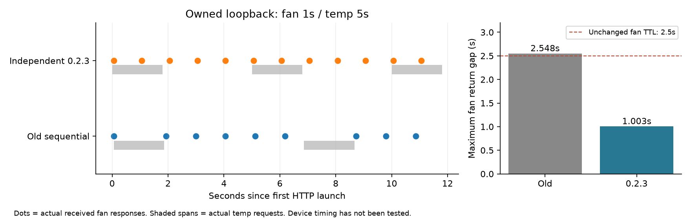
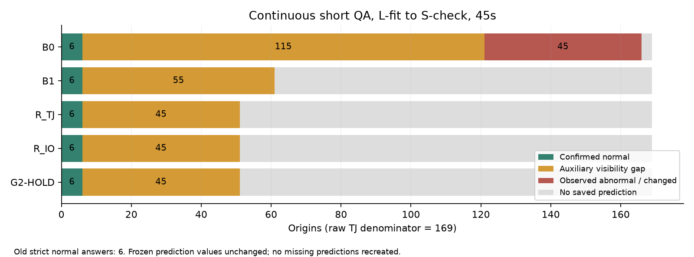
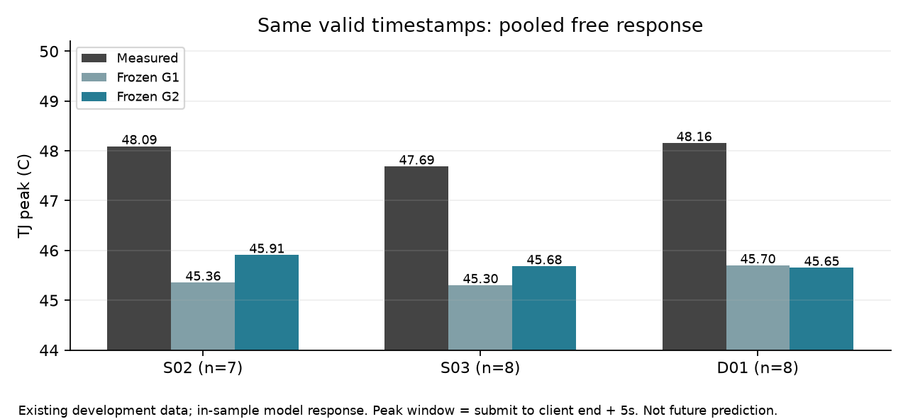

# TTO 软件修改与中等负载测试准备报告

**TTO-PREP-MIDLOAD-v1.0｜0.2.3本地候选｜2026-10-13｜交独立复审**

本轮三件事已落地：首轮灰箱研究已建立本地索引并保留冻结模型；主机fan/temp轮询已改为独立排程；中等负载runner、自动打点、停止处理、新安装候选和一页操作卡已完成。**代码与离线验证完成，软件候选已准备；现场部署和实测未执行。**

在自己创建的loopback服务上，同样的fan 1秒/temp 5秒配置和temp 1.8秒响应条件下，原采集器最大fan返回间隔为2.548秒，新候选为1.003秒。没有扩大2.5秒fan有效期；fan自身慢或超时仍如实形成缺口。这证明共享等待可以改善，不能证明旧39处间隙都由它造成，也不能承诺真实设备永远连续。

新研究规则把“能否取得可信温度答案”与“未来功率/PWM是否完整”分开。连续短问答的旧严格45秒答案仍是6个；B0的166个已存预测现在分为6个正常、115个辅助观测缺口、45个明确异常/变化。G2只有原先已存的51个预测可评分，为6个正常＋45个辅助缺口，没有补发缺失预测。**这是评分问题定义的修正，没有让模型变准。**在这51个共同起点上，G2-RELAX30的45秒MAE为1.525°C，B0为1.369°C，仍未胜出。

现场尚缺独立复审、用户确认的测试窗口、目标机候选安装身份和现场驻留/无其他任务及完整输入的确认；可选室温读数仍未知。最值得推进的是复审通过后，用固定AUTO/曲线/gain取得20/60/180秒中等工作块的新开发数据，辨别现有模型漏掉的短峰与持续加热过程。本轮到此停止。

|交付状态|结果|
|---|---|
|代码与离线验证|完成：生产关联回归50项，runner及新资格24项通过|
|安装候选与操作工具|已准备：0.2.3 wheel、Conda安装候选、runner、本地目标配置和操作卡|
|现场部署和实测|未执行|
|新模型训练|未执行|
|风扇控制改动|无|
|下一步|先独立复审；通过后由用户确认现场窗口|

## 1. 修改位置与原成果保护

原工作树HEAD为 `97546ba3b403c02d1b9f81aa9fa50276355a4fd3`，已有未提交工作原样保留。本轮在 `evidence/prep-midload-v1/candidate/` 建立独立本地checkout和 `research/midload-prep-v1` 分支，基线为 `a27ddb6f41c887fd9f08d4120f98d97eed31f4d0`；其运行源码与原工作树的0.2.2逐字一致。没有提交、推送、创建PR或合并main。此前发布的灰箱分支属于历史动作，本轮没有继续发布。

最终核对了原工作树4289个既有文件的SHA，全部未变；首轮证据manifest列出的222个文件全部未变。原日志、原配置、旧模型、旧split、test-used、旧成绩和报告没有移位或覆盖。六个G1/G2模型副本逐字相同，仍为 `deployable=false`。36个主拟合尝试及其失败/边界结果均按原SHA保留，没有运行拟合入口或训练测试。

归档入口为候选README → `docs/research/greybox-id-v1/README.md` → `evidence-index.json`，研究代码在 `experiments/thermal_identification_v1/`。大型原档保留本地，不强制放入代码分支。L/S为此前已分析的开发资料，F-SL为反向工况压力检查，F-POOL为拟合内表达能力检查；18条请求没有被标成18个独立热过程。

|冻结身份|SHA-256|
|---|---|
|本轮交接ZIP|`6cfaf4086073664088c7aea8d71142fcaada995334fe66d603cb5dc035c387ef`|
|首轮灰箱原证据ZIP|`d2039aafbc778a35ad223a7f6f9cac378e570a1ed67f8e9cf4962da8385ef546`|
|L分享归档|`0acc23fb82f6b7a4d9c898c903c69a491d38e740790309b19bb32048420a5a88`|
|S完整分享归档|`a560d8c03331ebb0d32f6ebefaf406efa6b951a35fddb62811aec355050bae6f`|
|上轮探索归档|`4daaa7b6c27fa47bb2f687e2d3a9e26601fbe885111267334cc6dc0c7e08680b`|

索引分别保存私有原件与分享归档的身份。S分享manifest SHA为 `2c5c6c3593b70dab6b3bdf2c1ea5425c49dc08d556235ceb2e211221720e8c3f`，私有manifest为 `51cd77db0f8748c3f6fb002a964a170208ddc783177f711a271d7c7f10402bfa`，没有混用。

## 2. 主机轮询改了什么，为什么

原真实采集器用同一个任务顺序请求fan和temp，下一次到期时间设为“返回时刻＋周期”。慢temp会挡住fan，响应耗时也叠加到周期。修改局限在 `src/tto/collector.py`：fan/temp各有一个独立worker和受限会话，各最多一个在途，合计最多两个；按单调钟到期时间排程，相邻实际发起不短于配置周期，错过时隙只记skip，不追赶突发。

fan/temp配置仍1秒/5秒，原采样频率和有效期不变。原配置字段 `network.max_inflight_esp32=1` 为旧固定配置合同，未静默改为2；0.2.3的实际独立端点合同在manifest和summary明确登记为 `TTO-POLL-INDEPENDENT-v1`、每端点1/合计2，并保留旧字段值。旧配置可复用，复核时以新版本显式运行合同理解实际并发。

每条轮询记录计划、实际发起、实际接收及RTT；原payload中的来源时间/年龄没有重打戳。取消只有取消事件，不产生成功PWM。summary按端点给出发送、HTTP成功/错误、skip、取消、并发峰值、RTT及发起/返回间隔统计。runner通过同一个采集流的回调观察健康，不另造诊断轮询器。

|同条件11.4秒测试|原采集器|0.2.3|
|---|---:|---:|
|fan成功返回数|9|12|
|最大fan返回间隔|2.547645秒|1.003338秒|
|服务侧每端点在途峰值|1/1|1/1|
|服务侧合计峰值|1|2|
|测试进程RSS最大值|50.77MiB|52.70MiB|
|单核口径CPU平均/最大|1.59% / 2.01%|1.83% / 2.67%|

资源数字来自macOS arm64同一pytest进程，包含自建服务与采集器，不能作为N305纯采集开销。原状态队列仍有界，结束在途为0；源质量、隔离、控制资格、生产evaluate/report均未改变。

fan自身1.4秒延迟测试展示真实skip及输入缺口，temp仍能工作；fan超时保留空payload和真实错误，未补PWM。401/403、外部停止、时长到期及原URL白名单/只读GET、TLS配置、禁止跳转、响应/队列预算均完成关联回归。

## 3. 新研究资格与覆盖

拟实现前已冻结 `results/pretest-spec.frozen.json` 和 `eligibility-rule-freeze.json`；新规则只在 `experiments/thermal_identification_prep_v2/` 写派生结果，版本 `TTO-EVAL-AVAIL-v2.0`。

四项分别记录：同源可信TJ答案；各方法当时输入及历史资格；未来实际功率/成功PWM完整性；控制上下文。原源处理器被直接复用，源身份变化、冲突/隔离、生命周期、序列和新鲜性边界仍排除非法标签。辅助可见性单独追踪，未知绝不写成全程正常AUTO。

**A**要求预测区间未来输入完整；fan/power间隙仍不能跨越。**B**只给已经保存且起点合法的预测评分：有可信同源TJ答案时，仅未来辅助缺口不会销毁误差；正常、辅助缺口、明确异常/改变和全部可信答案分别报告。每个15/45/90秒标签独立判断，不因90秒缺失删除45秒。当前PWM/完整60秒历史缺失时G1/G2/R_IO仍不合格，TJ方法按自身资格另列，不用后续数据补发。

读取的是首轮冻结离线回放预测，不是声称原现场曾发出这些预测。新结果每条保存原数值、缺失方法、资格、标签ref、原因及上下文ref；逐条断言原B值不变。原L12/S27个TTL区间拒绝及连续短问答6个45秒答案已复核。39处是严格输入可见性间隙，未改称39次设备失温。

|F-LS连续短问答，45秒|原始TJ|已存起点/预测|旧严格答案|新可信答案|正常|辅助缺口|明确异常/改变|
|---|---:|---:|---:|---:|---:|---:|---:|
|B0|169|166|6|166|6|115|45|
|B1|169|61|6|61|6|55|0|
|R_TJ / R_IO（各）|169|51|6|51|6|45|0|
|G1/G2 HOLD/RELAX30（各）|169|51|6|51|6|45|0|

共同集合均按“起点ref＋时距＋答案ref”登记SHA集合ID，先按方法层级取交集再比较；不是用不同覆盖的MAE宣称收益。下表来自F-LS连续短问答45秒的全方法共同集合，每格为点MAE（°C）；该资料已经参与开发分析。

|方法|全部可信答案 n=51|正常 n=6|辅助缺口 n=45|
|---|---:|---:|---:|
|B0|1.369|0.948|1.425|
|B1|2.778|3.413|2.694|
|R_TJ|1.602|1.611|1.600|
|R_IO|1.588|1.649|1.580|
|G1-HOLD|2.775|3.646|2.659|
|G1-RELAX30|1.888|1.966|1.878|
|G2-HOLD|2.717|3.447|2.620|
|G2-RELAX30|1.525|1.253|1.562|

该全方法集合没有明确异常样本；B0更宽集合中的45个异常仍在逐点证据和分层表中保留，未混入正常。其他实验、时距和共同方法层级见 `results/availability-v2/waterfall.json`、`comparisons.json`。没有把旧6点与新51点的数值差称为模型改善。

## 4. 短峰诊断与下一轮信息缺口

既有短脉冲按提交前30秒真实TJ中位数取描述参考，须至少20点且跨度25秒；未称冷机或热平衡。事件窗口为提交到客户端结束后5秒；回落分为0—5、5—15、15—45、45—90秒，保留TJ、成功PWM和严格输入覆盖。前一负载是否重叠及不同主机时钟语义均保留。温升面积为°C·s，未解释为热量或热容。

|事件|共同有效点|实测峰值°C|冻结合并G2峰值°C|G2峰差°C|窗口缺峰|
|---|---:|---:|---:|---:|---|
|S02|7|48.093|45.909|−2.184|否|
|S03|8|47.687|45.683|−2.004|否|
|D01|8|48.156|45.653|−2.503|否|

这些是旧合并模型自由响应的拟合内诊断，不是B未来预测或控制实验。峰差按同一有效时间集合计算，缺峰会单独标记；本次三个窗口均没有因对齐丢掉峰。结果支持取得持续时间更长、仍为单路的中等负载资料，不能仅用长待机的低MAE抹掉动态失败。

## 5. Runner、准入、停止与操作卡

入口 `scripts/thermal_trials/run_midload.py` 无参数默认离线；help/plan/dry-run在不可达但真实形式URL及凭据哨兵测试中均无外连、无凭据读取/输出。真实模式需显式 `--live`，本轮仅在自己创建的loopback上测试协议；没有真实请求预试。

单采集器保持原WS/采样/AUTO，健康检查复用它已处理的事件。开始一次只读核对服务宣告的模型和活动/排队数，不加载模型、不造常驻探测器。背景600秒包含前180秒检查，不额外增加采集器或等待段。每个工作块前检查近期60秒完整输入；当前输入未知暂停新请求且不延长发起窗口。明确保护、失温、停用、手动/控制绑定变化会锁定本轮停止后续负载，后续正常快照不自动恢复。

预登记排程：600背景 → M20 → 420回落 → M60 → 600回落 → M180 → 600最终回落。20/60/180秒为单路请求发起窗口，最后一个请求自然结束后才计回落；名义2480秒，含检查和收尾的硬预算2700秒。单请求最长30秒、窗口后drain最长30秒、整轮最多256请求、每条最多256生成token；请求题材为非敏感技术说明，采样字段保持原服务默认，不靠字数或强断请求卡时长。实际连续负载能否成立由下一轮记录证明，若负荷零散则保留，不自动补跑。

SSE分别记录首网络行、首实际内容、finish_reason、usage和DONE；普通JSON只能在完整响应到达后确认内容和结束。EOF/timeout/客户端取消均标服务器工作未知，停止后续请求，不编造取消接口，不杀服务。Ctrl-C与采集退出只清理自己的任务。总截止预留10秒收尾；注入时钟验证完整排程、自然越界、暂停、未知超时、计数上限和硬截止。loopback集成用真实HTTP/SSE协议、缩短排程和模拟采集回调；生产采集器另以真实自建WS/HTTP服务验证，未称实机整轮验证。

自动输出唯一UTC目录、原始采集、请求原协议、计划/实际打点、配置/软件SHA、环境侧文件、输入覆盖、停止原因及trial-result.zip。未知室温保持null；环境观察与写入时刻分列。未来阶段计划和实际任务结束没有进入预测器，runner不加载研究模型或训练。

本地候选的 `site/local-midload.json` 已按旧记录填写原接口与模型；配置来源、旧TTO路径在 `site/local-profile-provenance.json`，没有向真机验证。公共模板及patch没有私有端点或令牌。四步操作卡含实际入口、离线预览、未来唯一现场命令、输出、停止和回退，详见 `code/docs/TTO中等负载测试操作卡.md`；现场缺室温时仍可采开发数据，但不能声称区分等效边界和慢初态。

## 6. 安装候选与离线验收

运行包发生变化，版本已从0.2.2增为0.2.3。仅增加必要版本/manifest及安装器可识别0.2.3的重试身份；原依赖锁不变，Conda便捷打包脚本携带runner、模板、操作卡及本地配置，全包manifest核对所有安装候选文件。旧wheel保持原位。

|新候选|SHA-256|
|---|---|
|0.2.3 wheel|`55dce2ac1804c353caf6b91baa76e66e76b1eb4816863f98bbb59421886502b6`|
|中等负载Conda安装候选ZIP|`dfdb673358dc8bebc645e555c2f21344fa406a4489b433f44bf386e4cc2f34b3`|
|候选ZIP内manifest|`3af7d268229df5a6de3f880e2e8e2260e964c308a901248688a62395c2da0a92`|
|可应用源码patch|`65d513690b1cc4b11c8cac3c9fa7e81dfe38ac13390f292de95969eed1ef9fc8`|

在开发机CPython3.10.18的全新非editable环境，逐文件核对源码＝wheel＝实际site-packages，锁定依赖版本一致，并用 `python -I -m tto doctor` 确认离线入口。又从本次ZIP解出候选，用现有离线Conda/pip缓存完成Conda3.10.22真实安装及launcher doctor、runner dry-run。Conda只改本轮临时prefix，没有改base、旧配置或服务；目标N305未安装。identity JSON和完整日志均保留。

|清单|实际证据与结果|
|---|---|
|P01/P02|4289原文件及222首轮文件SHA不变；研究索引、模型副本及README入口完成|
|C01—C03|真实旧/新生产collect调用，受控慢temp；实际时间、并发和频率断言通过|
|C04|fan慢/超时仍记真实缺口及skip，temp独立；无补PWM|
|C05/C06|401/403、外部停止、时长、网络/队列关联回归；时间分列及实际资源保存|
|E01—E03|旧L12/S27/6点复核；未来fan/power缺口时A拒绝、B合法答案保留且不改值|
|E04/E05|起点缺PWM/历史不足按方法拒绝；异常分层、源冲突隔离不恢复|
|E06/E07|45/90独立资格；未来TJ改变不改保存B；无补发，各共同集合ID完整|
|E08|图、Markdown、JSON同源；峰值共同时刻及°C·s单位测试通过|
|W01—W04|默认零外连、完整排程快进、自然drain、EOF/超时未知、45分钟/256请求/Ctrl-C与采集退出|
|W05/W06|同采集流准入，原有效期；明确异常停止锁定；环境null/时钟/计划分列|
|W07|真实loopback SSE/JSON/首内容/DONE/早结束/EOF/timeout；未冒充设备验证|
|D01/D02|新wheel身份与全新venv/Conda实际安装；已实现的help/plan/dry-run/doctor及四步操作卡|
|D03|基线patch应用后逐文件相同，冻结资料不变、来源/SHA/失败日志齐全；无Git发布|

最终生产关联回归 **50 passed in 46.88s**，新runner/研究测试 **24 passed in 2.20s**。未扩展为全仓防御审查，未运行原研究中的拟合测试。开发中失败记录也保留：覆盖核对首次用了短问答阶段末而非原macro末，已恢复原169分母；注入时钟夹具、缺少测试run_id已修正；生产与runner同名conftest混跑导致收集失败后分开运行；原调度短观察窗被冷启动耗时截断，改为同条件11.4秒以包含第二次temp返回。wheel构建先缺本机setuptools，改用已有完整3.10构建环境。Conda离线先因缓存渠道及沙箱登记表失败，之后用已有conda-forge缓存、仅测试禁用环境登记并在新prefix完成；未更改安装器去绕过这些环境条件。没有隐去失败或为了过测试放宽质量规则。

## 7. 独立复核入口与停止位置

证据包README提供解包、SHA验证、安装候选、两组离线测试及仅重算资格/诊断的入口。`code/` 是可重跑的源码快照；patch针对上述基线，wheel单独提供并由manifest/SHA绑定。复核用L/S分享归档和首轮冻结回放所需子集随包保留，原完整首轮证据仍按SHA索引，不递归重复旧大型归档。

逐点资格在 `results/availability-v2/*-availability-v2.jsonl`；完整分母/覆盖和共同集合在waterfall/comparisons；请求/输入时序反例在 `results/polling-before-after.json` 及loopback日志；模型与私有/分享身份在 `code/docs/research/greybox-id-v1/evidence-index.json`；保护及patch验证在 `results/protection-and-patch.json`。这些均为本地/离线证据。

本轮未连接真实设备，未运行真实doctor/collect/shadow或推理请求，未部署、重启、调PWM/采样/AUTO/曲线/gain，未修改天山OS或WS，未使用CUDA，未训练或实现在线参数学习。潜在状态不是实测热容；本轮没有控制收益或现场放行结论。交回复审后停止，不自动转入现场或模型训练。
