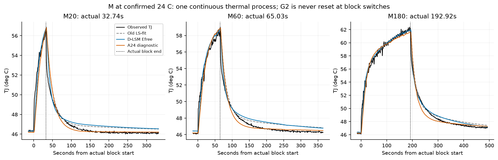
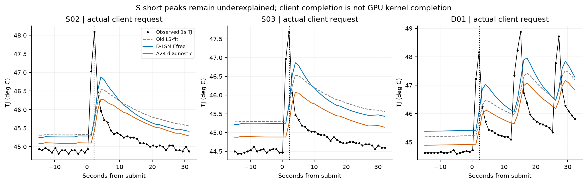
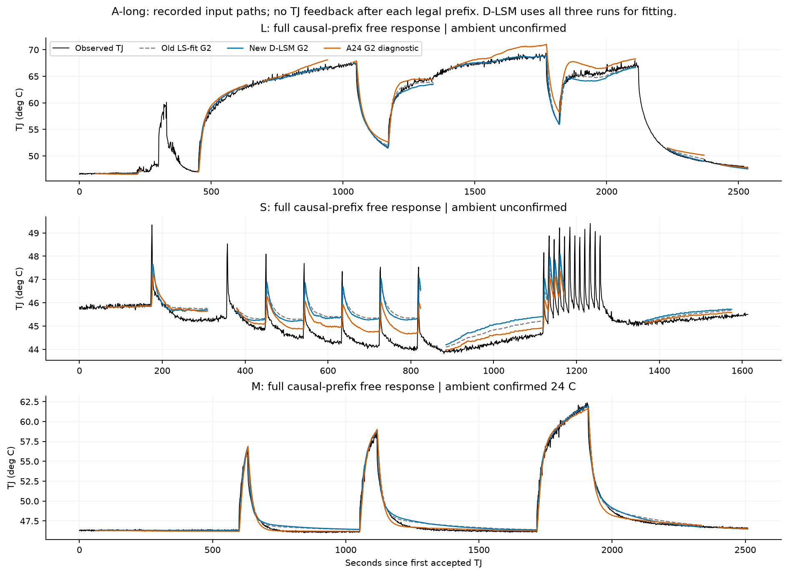
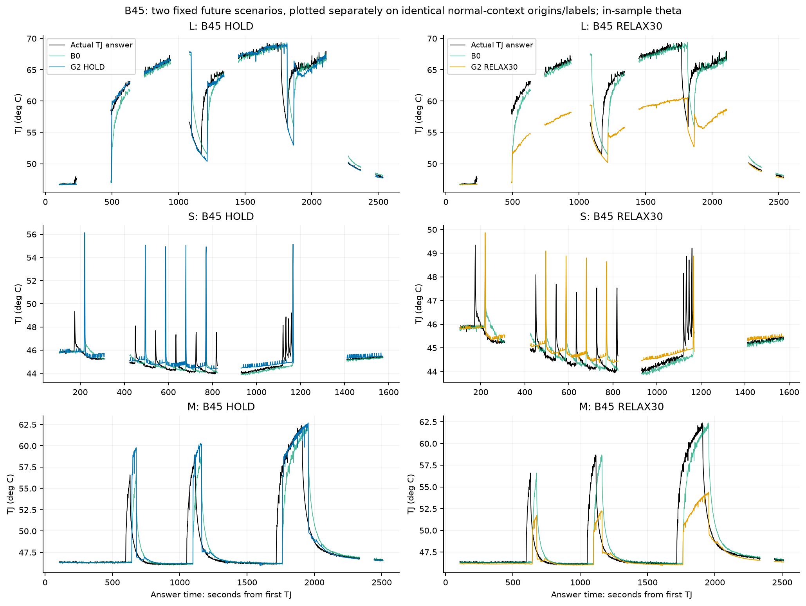
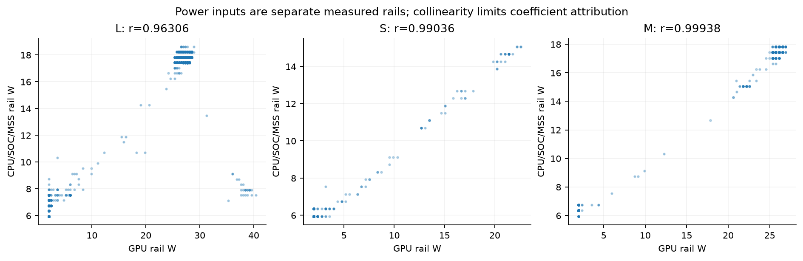

# TTO-旧模型新数据检验与第二轮辨识报告

2026-10-14 · TTO-ID-R2-v1.0 · 实际CPU离线研究 · 等待独立复审

已完成M数据登记、九份冻结旧模型的检验与封存，以及第二轮42次有界拟合和三组紧凑Ridge。G1拟合一个等效温度状态；G2拟合快/慢两个潜在温度状态，两者都实际使用GPU功率、CPU/SOC/MSS功率和成功PWM。它们是研究模型，不能解释为已经测到热容或完成在线学习。

**热响应有进展，通用未来预测仍未通过。** 旧主参照LS-fit G2已经能解释M的整段响应，MAE为0.369°C。加入M后，短侧拟合模型推到长任务的整段误差从13.753降到1.680°C；联合模型在M上从0.369降到0.319°C，但S从0.611变为0.631°C，没有全面改善。对真正45秒未来的预测，联合G2 HOLD总体仅从1.012变为1.007°C；短问答仍输给保持当前TJ。

最差仍在负载突变：联合G2的45秒HOLD在正常共同集合内出现约12°C最大欠预测；S02/S03/D01在实测热点时刻仍低估1.93–2.34°C。M持续升温和较晚回落有研究价值，短峰、结束后的前5秒回落以及未知未来任务切换仍有明显缺口。

M的24°C已按用户确认登记，并真正绑定到独立A24再拟合；原日志14份环境null保持原样。A24能解释M，但整体损失升高21.4%，GPU系数贴零边界，暴露出等效边界与高度共线功率输入之间的归因问题，不能据此质疑用户确认的室温。

**唯一推荐下一步：保持G2参数冻结，单独预登记一次“因果未来输入”离线实验。** 用预测起点已经到达的功率变化和请求在途状态，检验明确的未来功率情景是否优于固定HOLD；不读取后续实际结束时刻，不按误差事后选HOLD/RELAX30。本轮只提出这一项，完成交付后停止。

**材料身份与登记结果**

| 资料 | run ID | 新TJ数 | 严格当前资格数 | 严格段数 | ≥60秒段数 | 资料角色 |
| --- | --- | --- | --- | --- | --- | --- |
| L | 929742d7-6f4d-4d80-b53e-4436d45ac12c | 2529 | 2508 | 26 | 7 | 既有开发资料 |
| S | d2a7593a-e68a-4b6f-9d4d-875fafa73c02 | 1610 | 1606 | 30 | 4 | 既有开发资料 |
| M | 637f114b-563b-4c35-8062-a7588a89ce1c | 2504 | 2503 | 2 | 2 | 新增开发过程；现场准入override有记录 |

共6643份真实新TJ，来自三个热过程；M三个工作块、S十八条请求都不作为独立episode。M实际块长32.738/65.031/192.920秒，工作开始前TJ分别46.281/46.156/46.218°C。客户端协议完成时刻用于事件说明，不能等同GPU内核结束。

M原健康核对的首段完整输入约2336.380秒；本轮由实际accepted端点定义的拟合路径为2335.486秒，恢复段172.037秒。差别来自事件边界与温度采样端点，不是放宽资格。M-00贯穿全部三块及主要回落，M-01只在真实失温/恢复以后建立；不存在工作块重置。首段A-long在过去60秒之后连续自由传播约2275秒。尾部原异常及恢复原样保留。

L/S用首轮归档处理器，M用22份manifest源码SHA全部匹配的0.2.4处理器，均只回放文件。L/S的全部2529/1610份accepted温度、功率、源段、控制资格、序号、接收时间和宏类标签与首轮派生序列逐项相同。私有原件与分享归档的不同SHA单列在source-identity-supplement.json，未把脱敏归档身份当作私有原件身份。

24°C只绑定M run。它来自用户确认，不是逐秒环境传感器序列；仪器、位置、分辨率和准确确认时刻仍未记录。L/S室温保持未知；A24拟合得到的L/S等效E接近24也不能替它们补造室温。现场请求准入override从未用于放宽源质量、训练、PWM有效期或标签。

**冻结、资格和信息预算**

| 项目 | 本轮执行合同 |
| --- | --- |
| 主输入 | VDD_GPU、VDD_CPU_SOC_MSS分别以W输入；成功PWM/100；5V/gain/其他温区仅诊断 |
| 数值 | float64精确事件传播；真实接收时刻左持有；按实际有效期截断，不插值、不填零 |
| 源有效期 | 绑定实际accepted测量的年龄与截止时刻，不借后续被拒消息延长 |
| 标签 | 每个15/45/90秒独立取同源第一份t≥起点+h、偏移≤2秒的合法TJ |
| A-long | 每严格段过去60秒初始化后全段自由响应；不再吸收真实TJ |
| A-roll | 与B相同过去状态，额外读取名义h内完整真实输入，不读取未来TJ |
| B | 每真实新TJ一个起点；只用已到达信息；HOLD主情景、RELAX30独立诊断情景 |
| 初始化 | 每run第一个合法60秒前缀估计一次E，此后固定；真实中断后仅重新估计状态 |
| 状态 | G2用过去60秒估慢状态，当前TJ定快状态；参数不在线更新；60秒不代表热平衡 |
| RELAX30 | 30秒指数回落；每rail底值min(当前功率,本模型训练P10)；PWM保持当前 |
| 新规则 | TTO-EVAL-AVAIL-v2.0：未来辅助缺口不销毁B误差；A仍须完整未来输入 |
| 分层 | confirmed_normal / aux_observation_gap / observed_abnormal_or_changed / unclassified_gap；未知不写正常 |
| 比较 | 旧/新同规则、同60秒预算、同起点/同标签，记录origin_ref+horizon+label_ref的集合SHA |

本文性能主表采用confirmed_normal共同集合；辅助缺口、已观测异常与未知分别保留成绩和覆盖，不能混成正常结论。旧严格参考也单独计算。R_TJ/B0/B1按自身TJ历史资格报告；G1/G2/R_IO仍要求当前及过去输入完整。标签只因源身份/序号/隔离等真实质量问题或缺少答案而排除，不因没有90秒答案连带删除45秒。

spec与资料角色在首个M旧模型成绩前冻结；stage2-frozen-evaluation.json封存全部旧M逐点结果、规则/输入/模型/指标SHA后，阶段3才开始。D-LM和D-SM全部模型先冻结，再计算目标成绩。M及既有图表已被观察，不能称全盲；后续模型θ使用过L/S/M，联合成绩明确为拟合内。

阶段2封存SHA：`8db7e66fb46191827011b36f62835a356ef9bed8d7a66e17d82405fb0b68495d`。复算确认42次拟合全部发生在它以后；旧九份JSON SHA始终一致。

封存覆盖阶段2的状态、A/B逐点、主分层评分和覆盖。事件峰值/回落汇总与文字报告在交付阶段从这些封存轨迹后置派生，未在阶段3之前单独生成文字报告；这是相对于交接要求的流程差异。它们没有参与初值选择、没有改变旧成绩，最终SHA清单另覆盖这些派生产物，交独立复审确认。

**旧模型在M：A热响应**

| 旧参照 | 结构 | n | A-long MAE | 宏类均衡MAE | RMSE | 绝对P95 | 偏差 | 最大欠预测 |
| --- | --- | --- | --- | --- | --- | --- | --- | --- |
| L-fit（诊断） | G1 | 2382 | 0.716 | 0.825 | 1.251 | 3.356 | 0.196 | 4.559 |
| L-fit（诊断） | G2 | 2382 | 0.528 | 0.432 | 0.744 | 1.517 | 0.446 | 2.989 |
| S-fit（诊断） | G1 | 2382 | 7.663 | 6.023 | 10.604 | 22.677 | 7.549 | 4.351 |
| S-fit（诊断） | G2 | 2382 | 4.502 | 3.356 | 6.193 | 13.382 | 4.366 | 3.552 |
| LS-fit（预定主参照） | G1 | 2382 | 0.630 | 0.965 | 1.087 | 2.818 | -0.098 | 4.682 |
| LS-fit（预定主参照） | G2 | 2382 | 0.369 | 0.357 | 0.570 | 0.784 | 0.252 | 3.108 |

单位为°C。原S-fit在M持续升温/回落的整段误差很大，即使滚动状态能拉回部分误差也不能遮掉A-long失败。主参照LS-fit G2优于G1，主要证据是实际三块与回落的自由传播，而不是反复读真实TJ纠偏。

| 旧参照 | h秒 | 共同n | G1 A-roll MAE | G2 A-roll MAE | G2最大欠预测 | 集合SHA前12位 |
| --- | --- | --- | --- | --- | --- | --- |
| L-fit | 15 | 2351 | 0.274 | 0.191 | 2.997 | 70568ccb4fb4 |
| L-fit | 45 | 2291 | 0.554 | 0.276 | 2.985 | b0364339f73d |
| L-fit | 90 | 2201 | 0.718 | 0.375 | 2.979 | c94a757facb5 |
| S-fit | 15 | 2351 | 0.501 | 0.810 | 3.596 | 70568ccb4fb4 |
| S-fit | 45 | 2291 | 1.271 | 1.224 | 3.612 | b0364339f73d |
| S-fit | 90 | 2201 | 2.178 | 1.771 | 3.630 | c94a757facb5 |
| LS-fit | 15 | 2351 | 0.258 | 0.221 | 3.070 | 70568ccb4fb4 |
| LS-fit | 45 | 2291 | 0.509 | 0.251 | 3.069 | b0364339f73d |
| LS-fit | 90 | 2201 | 0.638 | 0.257 | 3.091 | c94a757facb5 |

A-roll读取未来真实功率/PWM，只说明热响应；它的误差不能替代下一表的真实未来预测。

**旧模型在M：B真实未来预测**

| 旧参照 | h秒 | 共同n | B0 | B1 | R_TJ | R_IO | G1 HOLD | G1 RELAX30 | G2 HOLD | G2 RELAX30 |
| --- | --- | --- | --- | --- | --- | --- | --- | --- | --- | --- |
| L-fit | 15 | 2351 | 0.503 | 0.514 | 0.462 | 0.472 | 0.350 | 0.383 | 0.370 | 0.489 |
| L-fit | 45 | 2291 | 1.310 | 1.828 | 1.550 | 1.600 | 1.125 | 1.161 | 1.147 | 1.248 |
| L-fit | 90 | 2201 | 2.243 | 4.015 | 3.075 | 3.171 | 2.147 | 1.794 | 2.150 | 1.753 |
| S-fit | 15 | 2351 | 0.503 | 0.514 | 0.611 | 0.650 | 0.575 | 0.465 | 0.918 | 0.846 |
| S-fit | 45 | 2291 | 1.310 | 1.828 | 1.413 | 1.726 | 1.872 | 1.111 | 1.848 | 1.379 |
| S-fit | 90 | 2201 | 2.243 | 4.015 | 2.251 | 1.891 | 3.698 | 1.902 | 3.235 | 1.980 |
| LS-fit | 15 | 2351 | 0.503 | 0.514 | 0.463 | 0.465 | 0.333 | 0.414 | 0.368 | 0.458 |
| LS-fit | 45 | 2291 | 1.310 | 1.828 | 1.354 | 1.366 | 1.111 | 1.344 | 1.103 | 1.287 |
| LS-fit | 90 | 2201 | 2.243 | 4.015 | 2.595 | 2.606 | 2.161 | 2.260 | 2.081 | 1.895 |

表中为时间加权MAE。三组旧参照各自保留原Ridge系数、缩放、λ与P10，没有看M成绩后改选旧胜者。旧主参照G2 HOLD的M工作块45秒MAE为4.278°C，B0为4.371°C；背景0.596°C、回落0.662°C。总体较低不代表任务切换时准确。

LS-fit G2的M首前缀拟合等效E=36.250°C、慢初态=42.582°C；恢复段沿用同一个E，只重新估慢状态。原参数θ不变，E没有被改成24°C。该前缀归一化列条件数4.352，未触发继承的弱秩回退；若触发，规则是固定为训练E中位数，再估慢态。

**加入M后的配对比较**

| 矩阵 | 拟合run | 目标run | 配对旧参照 | 结论角色 |
| --- | --- | --- | --- | --- |
| D-LM | L+M | S | L-fit | 开发跨任务检查；S此前已被研究 |
| D-SM | S+M | L | S-fit | 反向压力检查，不是未来时间泛化 |
| D-LSM | L+S+M | 逐轮L/S/M | LS-fit | 联合拟合内；公平重放仍使用过去前缀 |

| 矩阵 | 目标 | G1 A-long旧→新 | G2 A-long旧→新 | G2 A-roll45旧→新 | G2 HOLD45旧→新 | G2 RELAX30旧→新 | B0 45 | B共同n |
| --- | --- | --- | --- | --- | --- | --- | --- | --- |
| D-LM | S | 0.937→0.833 | 0.877→0.742 | 0.560→0.506 | 0.610→0.568 | 0.526→0.488 | 0.375 | 1010 |
| D-SM | L | 24.663→2.374 | 13.753→1.680 | 6.455→1.412 | 6.941→2.330 | 2.889→6.142 | 1.627 | 1544 |
| D-LSM | L | 1.421→1.451 | 0.367→0.387 | 0.341→0.315 | 1.242→1.247 | 6.088→6.374 | 1.627 | 1544 |
| D-LSM | M | 0.630→0.464 | 0.369→0.319 | 0.251→0.191 | 1.103→1.071 | 1.287→1.300 | 1.310 | 2291 |
| D-LSM | S | 0.664→0.748 | 0.611→0.631 | 0.356→0.409 | 0.455→0.495 | 0.354→0.384 | 0.375 | 1010 |

D-SM改善最明显：原短侧θ推到长负载时失真，M补入持续热响应后大幅收敛。但新HOLD45在L仍高于B0；新RELAX30在L明显变坏，因为持续任务中它会假定功率下降。这不是可逐点挑选更好情景解决的评分问题。D-LM在S的已知输入响应略好，仍未胜过简单未来预测基线。联合模型对M的改善是拟合内事实，L/S整段响应没有全面改善。

联合拟合旧→新的三轮共同正常集合总分，同时显示时间总分和run/宏类均衡总分：

| h秒 | 方法 | 共同n | 时间MAE旧→新 | 均衡MAE旧→新 | 新RMSE | 新绝对P95 | 新偏差 | 新欠预测P95 | 新最大欠预测 |
| --- | --- | --- | --- | --- | --- | --- | --- | --- | --- |
| 15 | B0 | 5234 | 0.508→0.508 | 0.615→0.615 | 1.239 | 2.781 | -0.039 | 1.344 | 8.125 |
| 15 | B1 | 5234 | 0.535→0.535 | 0.657→0.657 | 1.356 | 2.883 | -0.002 | 1.210 | 9.154 |
| 15 | R_TJ | 5234 | 0.476→0.465 | 0.579→0.554 | 1.151 | 1.727 | -0.062 | 1.045 | 8.116 |
| 15 | R_IO | 5234 | 0.482→0.491 | 0.584→0.593 | 1.189 | 2.286 | -0.027 | 1.168 | 8.093 |
| 15 | G1-HOLD | 5234 | 0.416→0.489 | 0.515→0.609 | 1.252 | 1.529 | -0.110 | 1.218 | 9.839 |
| 15 | G1-RELAX30 | 5234 | 0.665→0.805 | 0.683→0.799 | 1.444 | 2.599 | -0.555 | 2.270 | 9.925 |
| 15 | G2-HOLD | 5234 | 0.399→0.391 | 0.505→0.489 | 1.178 | 1.002 | 0.021 | 0.647 | 8.507 |
| 15 | G2-RELAX30 | 5234 | 0.791→0.906 | 0.744→0.823 | 1.582 | 2.950 | -0.671 | 2.779 | 8.603 |
| 45 | B0 | 4845 | 1.217→1.217 | 1.380→1.380 | 2.646 | 7.469 | -0.122 | 4.500 | 11.656 |
| 45 | B1 | 4845 | 1.737→1.737 | 2.113→2.113 | 3.872 | 10.449 | -0.019 | 6.530 | 22.523 |
| 45 | R_TJ | 4845 | 1.215→1.226 | 1.391→1.380 | 2.618 | 7.374 | -0.199 | 4.378 | 11.703 |
| 45 | R_IO | 4845 | 1.234→1.307 | 1.404→1.437 | 2.603 | 7.210 | -0.161 | 4.396 | 11.535 |
| 45 | G1-HOLD | 4845 | 1.171→1.333 | 1.444→1.652 | 3.015 | 9.211 | -0.292 | 3.432 | 14.767 |
| 45 | G1-RELAX30 | 4845 | 2.489→2.949 | 2.157→2.503 | 4.769 | 9.371 | -2.620 | 9.371 | 15.235 |
| 45 | G2-HOLD | 4845 | 1.012→1.007 | 1.286→1.269 | 2.727 | 8.724 | -0.019 | 2.856 | 11.986 |
| 45 | G2-RELAX30 | 4845 | 2.623→2.726 | 2.138→2.207 | 4.646 | 9.063 | -2.466 | 9.063 | 12.329 |
| 90 | B0 | 4260 | 2.055→2.055 | 2.157→2.157 | 3.883 | 10.375 | -0.262 | 8.066 | 13.938 |
| 90 | B1 | 4260 | 3.875→3.875 | 4.572→4.572 | 7.698 | 18.449 | -0.074 | 13.655 | 40.861 |
| 90 | R_TJ | 4260 | 2.225→2.109 | 2.345→2.178 | 3.869 | 10.286 | -0.380 | 8.093 | 13.969 |
| 90 | R_IO | 4260 | 2.246→2.302 | 2.360→2.313 | 3.809 | 9.815 | -0.251 | 7.882 | 13.582 |
| 90 | G1-HOLD | 4260 | 2.219→2.359 | 2.696→2.879 | 4.714 | 13.240 | -0.520 | 10.522 | 18.078 |
| 90 | G1-RELAX30 | 4260 | 4.678→5.275 | 3.831→4.283 | 8.505 | 17.318 | -5.067 | 17.318 | 19.204 |
| 90 | G2-HOLD | 4260 | 1.909→1.940 | 2.354→2.392 | 4.334 | 12.520 | -0.139 | 10.037 | 14.883 |
| 90 | G2-RELAX30 | 4260 | 4.199→4.323 | 3.349→3.459 | 7.302 | 14.435 | -4.151 | 14.435 | 16.676 |

Ridge没有因加入M而统一胜出：R_IO45在L从1.591升到1.847°C，M从1.366降到1.355°C，S从0.388降到0.371°C。每个时距的训练标签独立；标准化、CV和λ选择只用当前拟合侧。训练原点按完整严格段分组，最多3折，λ沿用0.01/0.1/1/10；截距不惩罚，alpha=λΣw，近似同分优先更大λ。所有折run/段/宏类与训练引用保存，CV仅为开发选参，不是独立验证。

**动态与背景分开看**

| run | 宏类 | 共同n | B0 45 | R_TJ 45 | R_IO 45 | G2 HOLD45 | G2 RELAX30 45 | HOLD最大欠预测 |
| --- | --- | --- | --- | --- | --- | --- | --- | --- |
| L | work | 1088 | 1.381 | 1.491 | 1.692 | 0.943 | 8.177 | 10.939 |
| L | recovery | 268 | 3.647 | 3.569 | 3.614 | 3.240 | 3.390 | 11.986 |
| L | background | 188 | 0.175 | 0.174 | 0.224 | 0.169 | 0.168 | 1.251 |
| S | work | 177 | 0.743 | 0.723 | 0.820 | 1.086 | 0.592 | 0.862 |
| S | recovery | 721 | 0.308 | 0.318 | 0.283 | 0.391 | 0.359 | 4.260 |
| S | background | 112 | 0.226 | 0.245 | 0.229 | 0.226 | 0.218 | 3.491 |
| M | work | 290 | 4.371 | 4.362 | 4.400 | 4.130 | 5.557 | 11.214 |
| M | recovery | 1464 | 0.964 | 0.919 | 1.008 | 0.642 | 0.667 | 11.359 |
| M | background | 537 | 0.605 | 0.620 | 0.663 | 0.594 | 0.732 | 10.297 |

回落前5秒的自由响应仍不准确。G2在M20/M60/M180这一窗口的MAE分别2.621/2.526/2.646°C；15–45秒分别0.143/0.087/0.316°C。较晚回落有价值不能抹掉最初快速降温的失败。背景保留参与权重，但M背景内起点可能在45秒内迎来任务启动，所以背景起点误差也不等同静态稳态误差。

**峰值、回落与时间对齐**

| M工作块 | 实际秒数 | 起始TJ | 实测峰值 | 旧G2峰差 | 新G2峰差 | A24峰差 | 新峰时差秒 | 峰窗共同n | 覆盖 |
| --- | --- | --- | --- | --- | --- | --- | --- | --- | --- |
| M20 | 32.738 | 46.281 | 56.593 | -0.131 | 0.053 | -0.032 | 0.000 | 32 | 100.000% |
| M60 | 65.031 | 46.156 | 58.687 | 0.236 | -0.002 | 0.137 | 4.001 | 65 | 100.000% |
| M180 | 192.920 | 46.218 | 62.375 | -0.403 | -0.409 | -0.764 | 3.005 | 193 | 100.000% |

峰差=模型峰值−实测峰值，按同一有效时刻集合取各自峰；峰时差单列。M均100%覆盖工作块内accepted TJ。短问答继承submit至客户端完成后5秒的峰窗，另记其他请求重叠；以下保留实测峰时刻误差，防止“晚到的较高模型峰”掩盖瞬时欠预测：

| S请求 | 实测峰TJ | 旧峰值差 | 新峰值差 | 旧在实测峰时误差 | 新在实测峰时误差 | 新峰时差秒 | 共同n | 覆盖 |
| --- | --- | --- | --- | --- | --- | --- | --- | --- |
| S02 | 48.093 | -1.556 | -1.210 | -2.424 | -2.339 | 2.001 | 7 | 100.000% |
| S03 | 47.687 | -1.160 | -0.825 | -2.019 | -1.934 | 2.003 | 8 | 100.000% |
| D01 | 48.156 | -1.689 | -1.129 | -2.454 | -2.089 | 2.002 | 8 | 100.000% |

M三块回落各窗口的A-long G2 MAE（旧LS-fit / 新Efree / A24）：

| 块 | 完成后秒窗 | 真实TJ n | 旧G2 | 新G2 | A24 G2 |
| --- | --- | --- | --- | --- | --- |
| M20 | [0, 5] | 5 | 2.794 | 2.621 | 2.872 |
| M20 | [5, 15] | 10 | 2.102 | 1.048 | 2.151 |
| M20 | [15, 45] | 30 | 0.331 | 0.143 | 0.369 |
| M20 | [45, 90] | 45 | 0.195 | 0.325 | 0.348 |
| M20 | [90, 300] | 209 | 0.470 | 0.552 | 0.086 |
| M60 | [0, 5] | 5 | 3.021 | 2.526 | 2.895 |
| M60 | [5, 15] | 10 | 2.142 | 0.965 | 1.920 |
| M60 | [15, 45] | 30 | 0.349 | 0.087 | 0.463 |
| M60 | [45, 90] | 45 | 0.297 | 0.512 | 0.518 |
| M60 | [90, 300] | 210 | 0.645 | 0.684 | 0.149 |
| M180 | [0, 5] | 5 | 2.979 | 2.646 | 2.594 |
| M180 | [5, 15] | 10 | 1.644 | 0.669 | 1.234 |
| M180 | [15, 45] | 30 | 0.279 | 0.316 | 0.737 |
| M180 | [45, 90] | 45 | 0.165 | 0.189 | 0.867 |
| M180 | [90, 300] | 209 | 0.489 | 0.372 | 0.179 |

所有L工作阶段、S十八条请求、M三块及五段回落窗均保存于event-metrics.json，包括共同引用、漏掉实测峰的标记、有效秒数及其他任务重叠；无删除不利脉冲。温升面积单位°C·s，仅为温度轨迹描述，不是焦耳。

**24°C边界与参数诊断**

| 候选 | 训练择优初值 | Huber J | 动态+E+慢初态自由度 | 收敛/6 | 5%内初值 | 择优贴边 |
| --- | --- | --- | --- | --- | --- | --- |
| D-LM-G1 | N6 | 4.197 | 4+2+0=6 | 6 | N1,N2,N3,N4,N5,N6 | 无 |
| D-LM-G2 | N3 | 1.007 | 6+2+28=36 | 6 | N1,N2,N3,N4,N5,N6 | 无 |
| D-LSM-G1 | N2 | 3.630 | 4+3+0=7 | 6 | N1,N2,N3,N4,N5,N6 | 无 |
| D-LSM-G2 | N1 | 1.167 | 6+3+58=67 | 6 | N1,N2,N3,N4,N5,N6 | 无 |
| D-LSM-G2-A24 | N1 | 1.417 | 6+2+58=66 | 6 | N1,N2,N3,N4,N5,N6 | b_g |
| D-SM-G1 | N3 | 2.257 | 4+2+0=6 | 6 | N1,N2,N3,N4,N5,N6 | 无 |
| D-SM-G2 | N1 | 0.974 | 6+2+32=40 | 6 | N1,N2,N3,N4,N5,N6 | 无 |

42/42实际尝试数值收敛；每组只按对应训练J择优，求解次数和残差调用均未超预算。Huber转折0.3°C不代表验收线。A24真正从优化变量移除E_M，67降为66个自由度，L/S仍各有自由E；没有加偏置、常数热源或环境曲线来抵消约束。每个真实严格段一个慢初态，所以联合模型含58个慢初态，不应只说“六个参数”。许多短段初态信息弱，完整缩放Jacobian存在近零奇异值，不能把收敛当作参数可唯一识别。

| G2候选 | a | c | d0 | d1 | b_g | b_c | 训练E_L | 训练E_S | 训练E_M |
| --- | --- | --- | --- | --- | --- | --- | --- | --- | --- |
| D-LM | 0.196 | 0.017 | 0.006 | 0.008 | 0.036 | 0.071 | 38.991 | — | 37.556 |
| D-SM | 3.659 | 0.053 | 0.004 | 0.013 | 0.481 | 0.656 | — | 33.023 | 32.945 |
| D-LSM | 0.115 | 0.012 | 0.005 | 0.008 | 0.018 | 0.062 | 36.257 | 34.315 | 34.976 |
| D-LSM-G2-A24 | 0.064 | 0.006 | 0.002 | 0.005 | 0.000 | 0.071 | 23.871 | 24.374 | 24.000 |

Efree联合E_M=34.976°C，与确认室温24°C相差10.976°C；这是拟合的等效边界，不是环境测量。A24总体J从1.167升到1.417，约+21.4%；因果前缀A-long的L/M/S分别0.950/0.259/0.387°C，而Efree为0.387/0.319/0.631°C。A24使M和S较好、L变差，不能拿单独M胜出取代主矩阵结论。GPU热增益约1.36e-39贴零，而CPU/SOC/MSS吸收了主要热输入贡献。

两rail的Pearson相关L=0.96306、S=0.99036、M=0.99938，M新增了持续时间信息，却几乎没有新增功率比例独立激励。这解释了为何响应可改善、GPU/CPU分担却仍不可靠；不能从贴零推断GPU不发热。闭环PWM与功率/温度相关也限制物理归因，gain只记录诊断，没有作为热输入。

六初值的J、近优参数范围、逐参数±1%尺度敏感性、缩放Jacobian奇异值、各run残差自相关及局部代数时间尺度/稳态增益均已保存。S+M的a≈3.659，对应快时间尺度约0.269秒；1秒遥测不能证明这种亚秒热常数。潜在慢状态也不是TTP或实测热容。TJ几乎贴近所报温区最高值，M的TJ−最高温区最大绝对差0.375°C；热点近似只是对报告温度的近似。

D-LSM训练初态重建与公平因果评价分别存储。前者使用全段优化E/Ts，只称拟合能力；后者对新旧都使用过去60秒同预算。主参数敏感性是已登记解的代数扰动，没有追加优化、d1=0或180秒窗口重跑。残差保留时间相关与升/降温系统性偏差，不能当作独立随机误差给出置信区间。

**覆盖率与规则变化**

| run | 45秒方法 | 全accepted分母 | 可发 | 可评分 | 覆盖 | 旧严格评分 | 正常 | 辅助缺口 | 异常/变更 | 未知 |
| --- | --- | --- | --- | --- | --- | --- | --- | --- | --- | --- |
| L | B0 | 2529 | 2529 | 2484 | 98.221% | 1962 | 1962 | 346 | 97 | 79 |
| L | R_TJ | 2529 | 2469 | 2424 | 95.848% | 1902 | 1902 | 346 | 97 | 79 |
| L | R_IO | 2529 | 1858 | 1813 | 71.688% | 1544 | 1544 | 175 | 45 | 49 |
| L | G2-HOLD | 2529 | 1858 | 1813 | 71.688% | 1544 | 1544 | 175 | 45 | 49 |
| S | B0 | 1610 | 1610 | 1565 | 97.205% | 1248 | 1248 | 269 | 48 | 0 |
| S | R_TJ | 1610 | 1550 | 1505 | 93.478% | 1188 | 1188 | 269 | 48 | 0 |
| S | R_IO | 1610 | 1190 | 1184 | 73.540% | 1010 | 1010 | 174 | 0 | 0 |
| S | G2-HOLD | 1610 | 1190 | 1184 | 73.540% | 1010 | 1010 | 174 | 0 | 0 |
| M | B0 | 2504 | 2504 | 2458 | 98.163% | 2412 | 2412 | 0 | 46 | 0 |
| M | R_TJ | 2504 | 2443 | 2397 | 95.727% | 2351 | 2351 | 0 | 46 | 0 |
| M | R_IO | 2504 | 2382 | 2336 | 93.291% | 2291 | 2291 | 0 | 45 | 0 |
| M | G2-HOLD | 2504 | 2382 | 2336 | 93.291% | 2291 | 2291 | 0 | 45 | 0 |

例如L的G2/R_IO可评分1813点，其中175点未来辅助缺口、45点已观测异常/变更、49点未知；这些都保留，正常主表只用1544点。S保留174点辅助缺口。M保留跨尾部异常的45点，不称正常。起点使用1秒及新规则产生的覆盖变化单列，不能称模型算法提升。

| run | 保留层次 | 共同n | B0 MAE | G2 HOLD MAE | G2 RELAX30 MAE | 集合SHA前12位 |
| --- | --- | --- | --- | --- | --- | --- |
| L | aux_observation_gap | 175 | 1.949 | 1.842 | 5.236 | 2547ec950112 |
| L | observed_abnormal_or_changed | 45 | 1.101 | 1.203 | 9.352 | 7f25328b8228 |
| L | unclassified_gap | 49 | 0.372 | 0.141 | 0.342 | c9690c2af48a |
| S | aux_observation_gap | 174 | 0.529 | 1.037 | 0.665 | 0e31d72e93c2 |
| M | observed_abnormal_or_changed | 45 | 0.095 | 0.056 | 0.213 | d46c691da73f |

这些层次用于诊断，不能推出原异常状态允许模型控制。逐层集合完整SHA和全部方法指标见B-metrics.json，逐点来源引用见predictions.jsonl。

**验证、资源与可重跑交付**

新增研究测试18项全部通过，涉及质量/恢复、未来信息、24°C绑定、阶段顺序、六初值账目、Ridge训练侧缩放/时距资格和M不按工作块重置。另独立复算30123张主/配对评分表，4812次JSON回读抽样预测最大差0°C；核对1143份受保护文件和九份旧模型SHA不变。没有重跑产品189项、安装器或全仓防御检查。

成果ZIP另在全新临时目录解压、逐成员核SHA，并用原交接重新准备缓存后独立回放：同样30123张表与4812次预测通过、差值0，未增加任何真实拟合。新增文件patch在空目录git apply --check通过。独立副本只核对模型/成果，不冒称重新访问作者原工作树。

实际CPU研究环境：CPython 3.10.18、NumPy 2.2.6、SciPy 1.14.1、scikit-learn 1.6.1；BLAS单线程。冻结旧模型检查用时32.06秒、子进程峰值RSS573.89MiB；第二轮含评价用时128.74秒、峰值853.62MiB，低于2GiB参考值和2小时软预算。绘图另用现有CPython3.14/Matplotlib环境，没有改生产依赖。

执行中资源监测的系统进程枚举被本机沙箱拒绝，改用仅记录子进程的getrusage；派生事件脚本曾遗漏A-long的wall字段，已按冻结原始ref回连UTC；图表核对后明确补足S的完成后5秒峰窗与实测峰时误差。原始资料、spec、拟合、阶段2封存和主评分均未因此改写；日志和修正说明保留。

证据包含独立研究代码及新增文件patch、冻结spec/角色、阶段2封存、42次尝试、七个新灰箱模型、三份Ridge模型、逐点A/B、训练初态重建、诊断、六组PNG/SVG图、测试/复算与资源。原六个大归档及首轮完整证据只用原交接inputs的SHA引用，不重复递归塞入。独立入口见README-R2.md：bootstrap.py核验原交接并备缓存；research.py的register/frozen/refit/all顺序执行且校验封存；readback.py可只复算现有成果，无须新增拟合。

| 最终状态 | 值 |
| --- | --- |
| data_registered | completed |
| old_models_evaluated | completed_and_sealed |
| refit_completed | completed_42_attempts |
| response_assessed | completed_with_scene_limits |
| forecast_assessed | completed_no_universal_win |
| online_learning | not_implemented |
| deployed | not_performed |
| control_authorization | none |

**唯一下一步的可证伪检查**

预登记一个未来输入信息实验：保持G2结构、θ和60秒初始化固定，使用当时已经发生的提交/完成/在途记录与当前功率趋势，生成一套明确情景，先在现有资料上离线与固定HOLD同集合比较。至少同时检查45秒工作/回落分层MAE、P95和最大欠预测，不能以待机总体分数替代；若未来功率误差下降而温度预测仍不改善，则把剩余瓶颈定位到热点观测/动态近似。用户本轮不需要做现场操作，先独立复审成果；该建议未在本轮实施。

**原输入SHA索引**

| 输入 | SHA-256 |
| --- | --- |
| inputs/L-seven-conditions-original.zip | 0acc23fb82f6b7a4d9c898c903c69a491d38e740790309b19bb32048420a5a88 |
| inputs/S-shortqa-original-complete.zip | a560d8c03331ebb0d32f6ebefaf406efa6b951a35fddb62811aec355050bae6f |
| inputs/previous-exploration-evidence.zip | 4daaa7b6c27fa47bb2f687e2d3a9e26601fbe885111267334cc6dc0c7e08680b |
| inputs/greybox-v1-evidence.zip | d2039aafbc778a35ad223a7f6f9cac378e570a1ed67f8e9cf4962da8385ef546 |
| inputs/M-midload-original.zip | afdacbd4495cbbeb6cd00179a582d44bcd650779737df7b6dc6bd29db06096fb |
| inputs/M-independent-review.zip | c7a1853bd8836cbe426454f9106223e287468dbe556df85b8ddb7d45930d206c |

规则来源：本轮用户明确授权与24°C确认 → 交接01方案/同版JSON → 已实现TTO-EVAL-AVAIL-v2.0 → 历史首轮规格。旧模型、旧失败、旧spec/split/test-used保留；所有新研究模型deployable=false。完成后停止交回复审，无设备连接、新请求、控制修改、CUDA、在线参数更新、部署、提交、推送或PR。
