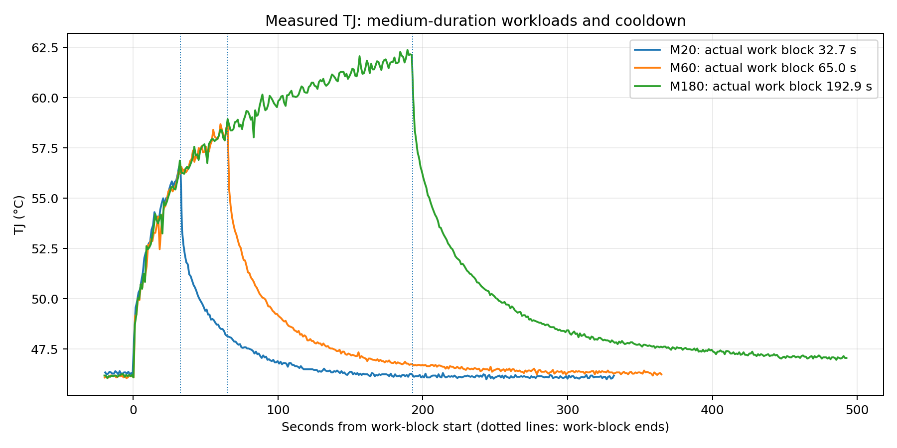

# TTO 0.2.4中等负载实测：独立数据核对与下一步

**核对日期：2026-10-14｜run：637f114b-563b-4c35-8062-a7588a89ce1c**

## 1. 结论与当前动作

**本轮完成了三种中等持续时间工作块，并留下足以进入下一轮灰箱开发辨识的真实记录。现在不需要重做这一轮，也没有从本次材料得出必须先再返修记录软件的结论。** 下一步是离线模型检查与再辨识，不是继续加测或修改风扇。

本轮应登记为“带明确任务准入覆盖说明的开发实验”，不能登记为未修改0.2.4测试工具的原样全流程验收。这个区别不使全部数据无效：原生产采集处理、源质量与记录仍保留；重新按未放宽的健康规则核对后，三段实际负载及其主要回落仍然连续可用。唯一被采到的设备失温标记出现在最后一条任务结束约7分7秒之后，不是负载执行期间。

模型状态没有改变：没有加载Ridge/G1/G2，没有新训练，也没有模型控制风扇。现在证明的是取得了更合适的建模材料，不是已经证明模型更准。

## 2. 原件、完整性与实际核验

输入：`TTO-0.2.4中等负载-完整实测证据.zip`，1,227,635字节。

SHA-256：`afdacbd4495cbbeb6cd00179a582d44bcd650779737df7b6dc6bd29db06096fb`。

内层`trial-result.zip` SHA-256：`979d9a4f547d4d2b4506772248606f45c700ee2b44315575be5bf9fc42cd2a5d`。

| 对象 | 本次独立完成 |
|---|---|
| 外层归档 | ZIP CRC正常，package-SHA256.json的42项大小/哈希匹配 |
| 内层实验归档 | ZIP CRC正常，SHA256.json的32项大小/哈希匹配 |
| 采集run | files.json的7项哈希匹配；不同层索引互相包含，不相加称独立实验 |
| 单独summary | 上传的runner-summary.json与内层summary.json逐字节相同 |
| 运行源码记录 | manifest的22份Python源码SHA与已交付、已核验0.2.4候选源码相同；不是本次访问远端文件系统重新验安装 |
| 原生产处理回放 | 8,028条原始观测经过同字节Engine重放，2,508次源接受/重复结果一致；491份基线预测与1,473条评分对象完整一致 |
| 原/覆盖后健康回放 | 通过包内两套健康逻辑重放，最后input-health.json与原件完整一致 |
| 原始请求协议 | 18份SSE的ID、DONE、usage、finish_reason与请求日志相符；请求不重叠，结束原因均length，256生成token/次，共4,608生成token |
| 统计复算 | 重新从原始观测、请求与阶段事件计算工作时长、温度/功耗/PWM、轮询间隔和严格连续区间 |

没有连接设备、推理服务或GitHub；没有更改任何原件、重训模型、切换风扇、部署或执行新负载。未重跑整套产品回归；这是一轮实测材料核对，不是再次全仓代码放行。

环境：Linux x86_64 / CPython 3.13.5 / NumPy 2.3.5。代码和资源的现场事实来自记录，本地核对环境不是目标N305。

复核脚本初次将`duration_s`与两次独立单调时钟读数之差要求一致到1e-8秒，触发校验；核对字段后采用1毫秒核算容差，18条实际最大差仅约22微秒。只修正独立核对程序的比较假设，没有修改请求日志或产品代码。

## 3. 实际执行了什么

北京时间2026-10-14 **01:37:47至02:19:38**，总计约**41分50.94秒**。文件名含20261013与原UTC日期一致，不要据文件名把北京时间也写成10月13日。

10分钟背景、三个工作块、7/10/10分钟回落全部完成；18/18协议完成，无请求重叠和未知结束。`collector_stop_reason=external_stop`对应runner正常完成后的结束采集，不应单独翻译成测试失败；最终`current_ready=false`来自关闭Socket.IO后的终态，同样不应当成整个测试期间始终不可用。

### 3.1 工作块与温度

下表采用各phase真实起止，温度峰值取该工作块内accepted新TJ，PWM峰值取该时间内成功fan快照。起始TJ是工作块开始前最后一份有效观测，不是热平衡温度。

| 工作块 | 计划发起窗口 | 请求数 | 实际块长 | 起始TJ | 块内TJ峰值 | 成功PWM峰值 |
|---|---:|---:|---:|---:|---:|---:|
| M20 | 20秒 | 2 | 32.74秒 | 46.281°C | 56.593°C | 73% |
| M60 | 60秒 | 4 | 65.03秒 | 46.156°C | 58.687°C | 80% |
| M180 | 180秒 | 12 | 192.92秒 | 46.218°C | 62.375°C | 86% |

实际块长大于20/60/180，是窗口结束后等待已经发出的请求自然完成，符合事先的排程语义；不是强制截断请求，也不是三条恰好运行20/60/180秒的请求。每条请求约14.11～19.34秒，正常按生成长度上限完成。

客户端请求在途时长占各实际工作块约99.76%、99.66%、99.63%。这不等同GPU内核忙碌率；独立的遥测表明，本轮确实形成较连续的热输入，而不只是少量相隔很远的短尖峰。

| 工作块 | GPU利用率均值 | VDD_GPU均值 | VDD_CPU_SOC_MSS均值 | VIN_SYS_5V0均值 |
|---|---:|---:|---:|---:|
| M20 | 88.27% | 24.013 W | 16.284 W | 15.240 W |
| M60 | 90.51% | 24.675 W | 16.665 W | 15.638 W |
| M180 | 90.86% | 25.618 W | 17.329 W | 16.170 W |

均值按实际接收时间左持有计权，包含块起止过渡。各rail独立，未相加当成整机功耗；1秒读数不提供精确芯片热功率或亚秒延迟证据。

图中按各工作块开始对齐，最多展示结束后300秒，并在下一工作块开始前截止；虚线为实际工作块结束。它是实测温度叠图，不是模型预测或因果A/B。

### 3.2 回落信息比仅看峰值更有用

取各块最后一次请求协议完成后目标时刻的第一份新TJ，偏移不超过2秒。附带的PWM是当时已收到的成功快照。

| 完成后 | M20 TJ/PWM | M60 TJ/PWM | M180 TJ/PWM |
|---|---|---|---|
| 约5秒 | 51.718°C / 73% | 53.375°C / 74% | 56.562°C / 78% |
| 约60秒 | 46.968°C / 27% | 47.812°C / 28% | 49.875°C / 32% |
| 约180秒 | 46.093°C / 18% | 46.437°C / 18% | 47.562°C / 18% |

以各块提交前30秒TJ中位数+1°C作为一个**描述参考**，首次回到该范围分别约51.1秒、91.7秒、231.7秒。这不是散热安全/热平衡标准，也不保证随后永不越界。

数据清楚呈现不同持续时间后的不同回落轨迹，足以支持下一轮比较快/慢状态模型；不能因此直接宣称测到了真实热容。

三块初始TJ很接近，但控制增益不同：约0.992、1.141、1.312；运行中又分别上调至约1.141、1.312、1.509。这些是既有控制器的状态，不是TTO在线学习成果。不得把73/80/86%完全归因于任务时长，也不得把三块当成只改变一个因素的独立因果实验。

## 4. 这轮记录连续性确实改善

原始8,028条观测包括2,508条Thor消息、2,508份fan、503份温度状态、2,507个tick及2条连接边界。2,508条Thor消息中2,504份新测量、4次重复；新测量来自同一流，最长相邻接收间隔约2.011秒。没有队列丢弃、业务报文超限或重复重连。

| 状态轮询 | 返回数 | HTTP错误 | 最大返回间隔 | RTT P95 |
|---|---:|---:|---:|---:|
| fan | 2,508 | 0 | 1.07484秒 | 14.066毫秒 |
| temperature status | 503 | 0 | 5.01199秒 | 13.072毫秒 |

每端点在途峰值1、总峰值2、结束在途0，与当前排程合同一致。fan有效期仍是2.5秒，没有靠扩TTL得到这些结果。

**按未放宽的原健康规则重放**，完整输入时间约2,508.713秒，不完整约1.956秒，占相应已观测时间约99.922%。其中起始连接准备约0.956秒，另有一次失温标记跨相邻快照约1.000秒。这个1秒是观测/资格区间，不能据此断言固件异常精确持续1秒。

完整连续输入可分为：

- 第一段约**2,336.380秒，即38分56秒**：从第一份完整源数据到最后回落期的失温标记之前，包含全部三段工作块及主要回落。
- 恢复后第二段约172.333秒：保留恢复后记录，不能当作异常从未发生。

这与之前大量fan快照2.5秒到期造成的短碎段明显不同。但旧/新现场负载与环境并非受控相同，不能将全部改善严格归因于单一代码改动，更不能保证以后永远没有通讯缺口。

### 4.1 下一轮研究起点的可用性盘点

按原始新TJ逐秒考察：起点前60秒具备严格完整输入，且未来同源TJ标签及严格输入区间完整时，三段工作块各有：

| 工作块 | 新TJ起点 | 具备60秒过去历史 | 合法45秒标签 | 合法90秒标签 |
|---|---:|---:|---:|---:|
| M20 | 32 | 32 | 32 | 32 |
| M60 | 65 | 65 | 65 | 65 |
| M180 | 193 | 193 | 193 | 193 |

这是**新研究数据资格盘点**，不是本次已发G2预测数；模型没有加载，不能补写它历史上已经预测过。下一轮实际模型入口仍需按自己的固定特征与状态历史核对，并为其写独立实验身份。

资源记录：N305上的采集/runner同进程单核CPU口径均值约2.455%，P95约5.986%，RSS峰值约43.883 MiB。包含本次同进程任务开销，不是纯采集器隔离测量，更不是训练或有灰箱模型时的实时计算性能。极小负CPU差分约−2.2e−14%为原浮点记录，未回写原值。

## 5. 必须保留的任务准入变更与单次红叉

包内`override-policy.json`和runner-summary明确登记了另行授权的覆盖：在固定TJ变量绑定、非手动温度等条件下，某些主板stale/invalid/default状态不再直接终止本轮请求排程。生产采集/质量处理没有按这套覆盖重新定义，原判定快照仍保留。

本次材料能证明“存在这份授权转述和执行副本”，本次没有重新访问该其他对话去独立核验授权全文；也没有据此自动允许任何下一轮操作。

**实际发生的唯一失温快照：北京时间02:16:44.697。** 前一份正常快照PWM18%，该帧stale=true/PWM25%，下一份采到的正常快照又为18%。没有采到guard或fault，主板温度状态轮询没有valid=false/default；原因不调查。

它发生在最后一条请求完成约426.751秒之后，三个工作块都早已结束，后面没有新推理请求。包内三次工作块准入时，原规则快照也都是当前可用、连续60秒、无异常。因此，不需要因这个末段标记把全部加载数据作废。

但是：

1. 不把该事件及其控制恢复影响包装成正常散热改进；正常模型拟合/传播按相应旧规则分段，或在新预登记规则下明确分层。
2. 不以覆盖后的2,509.714秒连续数字代替原规则的2,336.380秒最长正常段。
3. 不写“未经修改的0.2.4原生停止机制现场全通过”。本轮完整流程使用了独立覆盖副本，其结果角色就是开发实验。
4. 不把runner停止条件的调整说成改了风扇曲线、风扇保护或模型；也不把“忽略标记”说成证明了标记无害。

本次不建议为这个末段事件重跑整轮，也不重新打开通讯根因调查。保存事实与分析资格即可。

## 6. 仍未获得哪些信息

- 14份ambient_snapshot的环境温度均为空。不能将E_r设为某个未经测量的室温，不能宣称这次已区分环境变化与慢状态。未知环境不妨碍继续本轮开发辨识。
- 当前只有一个新完整过程，三个工作块和18条请求不是18个独立实验。
- 源/固件完整部署身份在manifest仍未填写；TTO实际记录的源码SHA可以对应旧候选，不自动补齐另两个项目的身份。这不必无限阻挡数值探索，但限制跨版本与物理参数结论。
- 模型文件为null；491个现场预测起点只包含persist/trend30。没有新的G2效果、在线学习效果、降噪效果或控制收益结果。

## 7. 下一步：先检查旧候选，再更新参数

**用户现在不需要再测，Codex也不应先开启另一轮采集器/风扇返修。**

1. 将本轮作为第三个开发过程M登记。保留原/覆盖后资格、源记录、时间与异常位置；相应资料归档，不改原字节。
2. 先用上轮冻结G1/G2和紧凑Ridge在M上做事后检查：参数固定，仅按事先定义的过去前缀初始化；A已知输入响应与B真实信息预测分开，HOLD/RELAX30分别报告。不要先吸收M重训，然后把它叫“旧模型通过新数据”。M原本就是计划的开发辨识过程，此时即使参数未用过M，也不将它改名为事先预登记的最终确认。
3. 再预登记第二轮辨识，利用新增中等持续热输入调整原模型参数。保留旧参数和刚才的检查结果；若用L+S+M联合拟合，明确报告拟合内成绩，不称独立泛化。重点检查持续热增益、短峰/回落和参数稳定性，不用低背景MAE淹没负载误差。
4. 只有这轮离线结果仍指向明确的信息缺口时，再提出下一组具体测试。真正的最终确认应在候选与规则冻结后另留新过程。当前不需要立即凑更多实验数、不增加状态阶数或无限扩初值。

**本轮的进展是：中等时长热过程补到了，主要记录连续性瓶颈在这次运行中没有重现；下一步应该回到模型本身。**

## 8. 复核产物与入口

`results/integrity.json`、`request_protocol.json`、`replay.json`、`strict_intervals.json`、`phases.json`、`raw_summary.json`和`prospective_coverage.json`保存对应数值、方法边界与原始ref。`review.py`可读取原ZIP，在独立目录复核；`reference_code/tto/`为已交0.2.4、与本run记录SHA对应的生产处理源码。没有用移动GitHub main替换现场证据。
